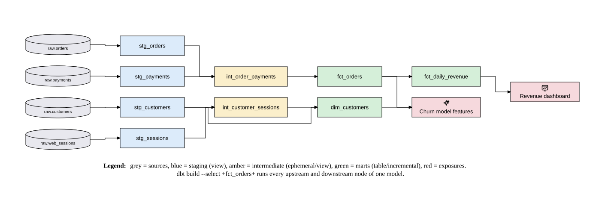

# dbt Model Lineage DAG

## Bill of Materials

| Symbol / ID | Label | Kind | Group | Technical Notes / Metadata |
| :--- | :--- | :--- | :--- | :--- |
| `shape_1` | **raw.orders** | cylinder | - | - |
| `shape_2` | **raw.customers** | cylinder | - | - |
| `shape_3` | **raw.payments** | cylinder | - | - |
| `shape_4` | **raw.web_sessions** | cylinder | - | - |
| `shape_5` | **stg_orders** | box | - | - |
| `shape_6` | **stg_customers** | box | - | - |
| `shape_7` | **stg_payments** | box | - | - |
| `shape_8` | **stg_sessions** | box | - | - |
| `shape_9` | **int_order_payments** | box | - | - |
| `shape_10` | **int_customer_sessions** | box | - | - |
| `shape_11` | **fct_orders** | box | - | - |
| `shape_12` | **dim_customers** | box | - | - |
| `shape_13` | **fct_daily_revenue** | box | - | - |
| `shape_14` | **Revenue dashboard** | box | - | - |
| `shape_15` | **Churn model features** | box | - | - |

## Connections

| Source | Target | Protocol / Label | Style | Routing |
| :--- | :--- | :--- | :--- | :--- |
| **raw.orders** (`shape_1`) | **stg_orders** (`shape_5`) | - | solid | orthogonal |
| **raw.customers** (`shape_2`) | **stg_customers** (`shape_6`) | - | solid | orthogonal |
| **raw.payments** (`shape_3`) | **stg_payments** (`shape_7`) | - | solid | orthogonal |
| **raw.web_sessions** (`shape_4`) | **stg_sessions** (`shape_8`) | - | solid | orthogonal |
| **stg_orders** (`shape_5`) | **int_order_payments** (`shape_9`) | - | solid | orthogonal |
| **stg_payments** (`shape_7`) | **int_order_payments** (`shape_9`) | - | solid | orthogonal |
| **stg_sessions** (`shape_8`) | **int_customer_sessions** (`shape_10`) | - | solid | orthogonal |
| **stg_customers** (`shape_6`) | **int_customer_sessions** (`shape_10`) | - | solid | orthogonal |
| **int_order_payments** (`shape_9`) | **fct_orders** (`shape_11`) | - | solid | orthogonal |
| **stg_customers** (`shape_6`) | **dim_customers** (`shape_12`) | - | solid | orthogonal |
| **int_customer_sessions** (`shape_10`) | **dim_customers** (`shape_12`) | - | solid | orthogonal |
| **fct_orders** (`shape_11`) | **fct_daily_revenue** (`shape_13`) | - | solid | orthogonal |
| **fct_daily_revenue** (`shape_13`) | **Revenue dashboard** (`shape_14`) | - | solid | orthogonal |
| **dim_customers** (`shape_12`) | **Churn model features** (`shape_15`) | - | solid | orthogonal |
| **fct_orders** (`shape_11`) | **Churn model features** (`shape_15`) | - | solid | orthogonal |
