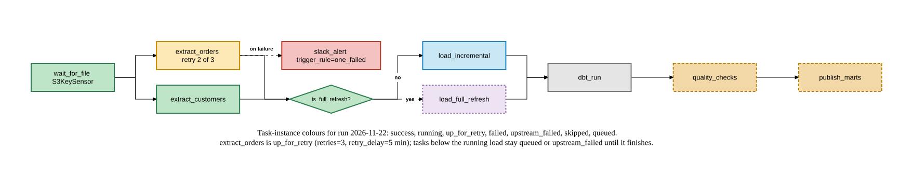

# Airflow DAG with Task States and Retries

## Bill of Materials

| Symbol / ID | Label | Kind | Group | Technical Notes / Metadata |
| :--- | :--- | :--- | :--- | :--- |
| `shape_1` | **wait_for_file S3KeySensor** | box | - | - |
| `shape_2` | **extract_orders retry 2 of 3** | box | - | - |
| `shape_3` | **extract_customers** | box | - | - |
| `shape_4` | **is_full_refresh?** | diamond | - | - |
| `shape_5` | **load_incremental** | box | - | - |
| `shape_6` | **load_full_refresh** | box | - | - |
| `shape_7` | **dbt_run** | box | - | - |
| `shape_8` | **quality_checks** | box | - | - |
| `shape_9` | **publish_marts** | box | - | - |
| `shape_10` | **slack_alert trigger_rule=one_failed** | box | - | - |

## Connections

| Source | Target | Protocol / Label | Style | Routing |
| :--- | :--- | :--- | :--- | :--- |
| **wait_for_file S3KeySensor** (`shape_1`) | **extract_orders retry 2 of 3** (`shape_2`) | - | solid | orthogonal |
| **wait_for_file S3KeySensor** (`shape_1`) | **extract_customers** (`shape_3`) | - | solid | orthogonal |
| **extract_orders retry 2 of 3** (`shape_2`) | **is_full_refresh?** (`shape_4`) | - | solid | orthogonal |
| **extract_customers** (`shape_3`) | **is_full_refresh?** (`shape_4`) | - | solid | orthogonal |
| **is_full_refresh?** (`shape_4`) | **load_full_refresh** (`shape_6`) | yes | solid | orthogonal |
| **is_full_refresh?** (`shape_4`) | **load_incremental** (`shape_5`) | no | solid | orthogonal |
| **load_incremental** (`shape_5`) | **dbt_run** (`shape_7`) | - | solid | orthogonal |
| **load_full_refresh** (`shape_6`) | **dbt_run** (`shape_7`) | - | solid | orthogonal |
| **dbt_run** (`shape_7`) | **quality_checks** (`shape_8`) | - | solid | orthogonal |
| **quality_checks** (`shape_8`) | **publish_marts** (`shape_9`) | - | solid | orthogonal |
| **extract_orders retry 2 of 3** (`shape_2`) | **slack_alert trigger_rule=one_failed** (`shape_10`) | on failure | dashed | orthogonal |
