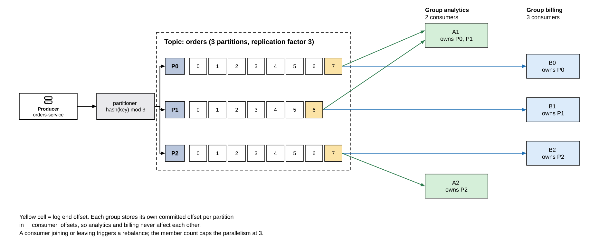

# Kafka Topic, Partitions and Consumer Groups

## Bill of Materials

| Symbol / ID | Label | Kind | Group | Technical Notes / Metadata |
| :--- | :--- | :--- | :--- | :--- |
| `shape_1` | ****Producer** orders-service** | box | - | - |
| `shape_2` | **partitioner hash(key) mod 3** | box | - | - |
| `shape_4` | ****P0**** | box | Topic: orders (3 partitions, replication factor 3) | - |
| `shape_5` | **0** | box | Topic: orders (3 partitions, replication factor 3) | - |
| `shape_6` | **1** | box | Topic: orders (3 partitions, replication factor 3) | - |
| `shape_7` | **2** | box | Topic: orders (3 partitions, replication factor 3) | - |
| `shape_8` | **3** | box | Topic: orders (3 partitions, replication factor 3) | - |
| `shape_9` | **4** | box | Topic: orders (3 partitions, replication factor 3) | - |
| `shape_10` | **5** | box | Topic: orders (3 partitions, replication factor 3) | - |
| `shape_11` | **6** | box | Topic: orders (3 partitions, replication factor 3) | - |
| `shape_12` | **7** | box | Topic: orders (3 partitions, replication factor 3) | - |
| `shape_13` | ****P1**** | box | Topic: orders (3 partitions, replication factor 3) | - |
| `shape_14` | **0** | box | Topic: orders (3 partitions, replication factor 3) | - |
| `shape_15` | **1** | box | Topic: orders (3 partitions, replication factor 3) | - |
| `shape_16` | **2** | box | Topic: orders (3 partitions, replication factor 3) | - |
| `shape_17` | **3** | box | Topic: orders (3 partitions, replication factor 3) | - |
| `shape_18` | **4** | box | Topic: orders (3 partitions, replication factor 3) | - |
| `shape_19` | **5** | box | Topic: orders (3 partitions, replication factor 3) | - |
| `shape_20` | **6** | box | Topic: orders (3 partitions, replication factor 3) | - |
| `shape_21` | ****P2**** | box | Topic: orders (3 partitions, replication factor 3) | - |
| `shape_22` | **0** | box | Topic: orders (3 partitions, replication factor 3) | - |
| `shape_23` | **1** | box | Topic: orders (3 partitions, replication factor 3) | - |
| `shape_24` | **2** | box | Topic: orders (3 partitions, replication factor 3) | - |
| `shape_25` | **3** | box | Topic: orders (3 partitions, replication factor 3) | - |
| `shape_26` | **4** | box | Topic: orders (3 partitions, replication factor 3) | - |
| `shape_27` | **5** | box | Topic: orders (3 partitions, replication factor 3) | - |
| `shape_28` | **6** | box | Topic: orders (3 partitions, replication factor 3) | - |
| `shape_29` | **7** | box | Topic: orders (3 partitions, replication factor 3) | - |
| `shape_32` | **A1 owns P0, P1** | box | - | - |
| `shape_33` | **A2 owns P2** | box | - | - |
| `shape_34` | **B0 owns P0** | box | - | - |
| `shape_35` | **B1 owns P1** | box | - | - |
| `shape_36` | **B2 owns P2** | box | - | - |

## Connections

| Source | Target | Protocol / Label | Style | Routing |
| :--- | :--- | :--- | :--- | :--- |
| ****Producer** orders-service** (`shape_1`) | **partitioner hash(key) mod 3** (`shape_2`) | - | solid | direct |
| **partitioner hash(key) mod 3** (`shape_2`) | ****P0**** (`shape_4`) | - | solid | orthogonal |
| **partitioner hash(key) mod 3** (`shape_2`) | ****P1**** (`shape_13`) | - | solid | orthogonal |
| **partitioner hash(key) mod 3** (`shape_2`) | ****P2**** (`shape_21`) | - | solid | orthogonal |
| **7** (`shape_12`) | **B0 owns P0** (`shape_34`) | - | solid | direct |
| **6** (`shape_20`) | **B1 owns P1** (`shape_35`) | - | solid | direct |
| **7** (`shape_29`) | **B2 owns P2** (`shape_36`) | - | solid | direct |
| **7** (`shape_12`) | **A1 owns P0, P1** (`shape_32`) | - | solid | direct |
| **6** (`shape_20`) | **A1 owns P0, P1** (`shape_32`) | - | solid | direct |
| **7** (`shape_29`) | **A2 owns P2** (`shape_33`) | - | solid | direct |
