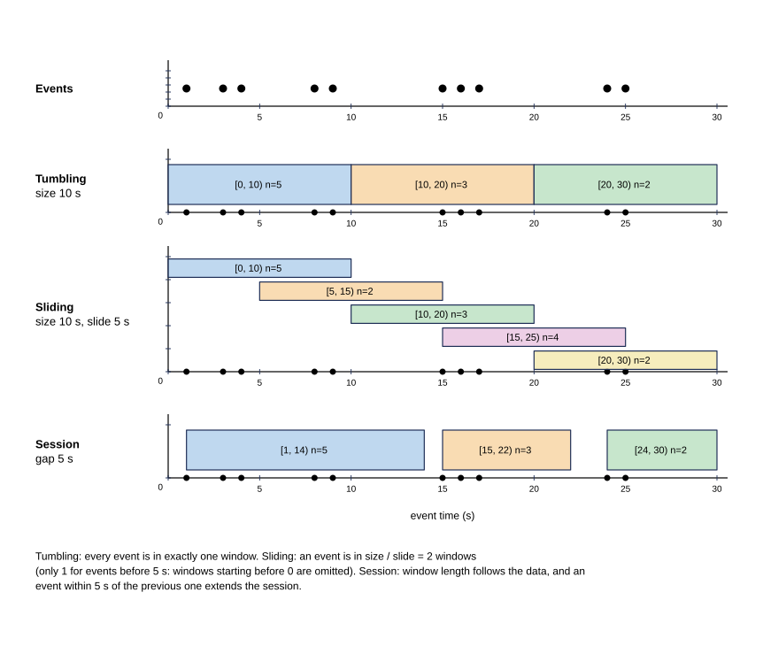

# Stream Windows: Tumbling, Sliding and Session

## Bill of Materials

| Symbol / ID | Label | Kind | Group | Technical Notes / Metadata |
| :--- | :--- | :--- | :--- | :--- |

## Connections

| Source | Target | Protocol / Label | Style | Routing |
| :--- | :--- | :--- | :--- | :--- |
| **point_1** (`point_1`) | **point_2** (`point_2`) | - | solid | direct |
| **point_3** (`point_3`) | **point_4** (`point_4`) | - | solid | direct |
| **point_24** (`point_24`) | **point_25** (`point_25`) | - | solid | direct |
| **point_26** (`point_26`) | **point_27** (`point_27`) | - | solid | direct |
| **point_53** (`point_53`) | **point_54** (`point_54`) | - | solid | direct |
| **point_55** (`point_55`) | **point_56** (`point_56`) | - | solid | direct |
| **point_86** (`point_86`) | **point_87** (`point_87`) | - | solid | direct |
| **point_88** (`point_88`) | **point_89** (`point_89`) | - | solid | direct |
