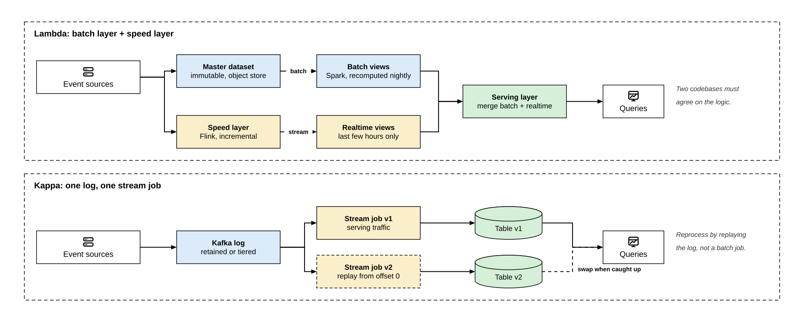

# Lambda versus Kappa Architecture

## Bill of Materials

| Symbol / ID | Label | Kind | Group | Technical Notes / Metadata |
| :--- | :--- | :--- | :--- | :--- |
| `shape_2` | **Event sources** | box | Lambda: batch layer + speed layer | - |
| `shape_3` | ****Master dataset** immutable, object store** | box | Lambda: batch layer + speed layer | - |
| `shape_4` | ****Batch views** Spark, recomputed nightly** | box | Lambda: batch layer + speed layer | - |
| `shape_5` | ****Speed layer** Flink, incremental** | box | Lambda: batch layer + speed layer | - |
| `shape_6` | ****Realtime views** last few hours only** | box | Lambda: batch layer + speed layer | - |
| `shape_7` | ****Serving layer** merge batch + realtime** | box | Lambda: batch layer + speed layer | - |
| `shape_8` | **Queries** | box | Lambda: batch layer + speed layer | - |
| `shape_10` | **Event sources** | box | Kappa: one log, one stream job | - |
| `shape_11` | ****Kafka log** retained or tiered** | box | Kappa: one log, one stream job | - |
| `shape_12` | ****Stream job v1** serving traffic** | box | Kappa: one log, one stream job | - |
| `shape_13` | ****Stream job v2** replay from offset 0** | box | Kappa: one log, one stream job | dash: 5,3 |
| `shape_14` | **Table v1** | cylinder | Kappa: one log, one stream job | - |
| `shape_15` | **Table v2** | cylinder | Kappa: one log, one stream job | - |
| `shape_16` | **Queries** | box | Kappa: one log, one stream job | - |

## Connections

| Source | Target | Protocol / Label | Style | Routing |
| :--- | :--- | :--- | :--- | :--- |
| **Event sources** (`shape_2`) | ****Master dataset** immutable, object store** (`shape_3`) | - | solid | orthogonal |
| **Event sources** (`shape_2`) | ****Speed layer** Flink, incremental** (`shape_5`) | - | solid | orthogonal |
| ****Master dataset** immutable, object store** (`shape_3`) | ****Batch views** Spark, recomputed nightly** (`shape_4`) | batch | solid | orthogonal |
| ****Speed layer** Flink, incremental** (`shape_5`) | ****Realtime views** last few hours only** (`shape_6`) | stream | solid | orthogonal |
| ****Batch views** Spark, recomputed nightly** (`shape_4`) | ****Serving layer** merge batch + realtime** (`shape_7`) | - | solid | orthogonal |
| ****Realtime views** last few hours only** (`shape_6`) | ****Serving layer** merge batch + realtime** (`shape_7`) | - | solid | orthogonal |
| ****Serving layer** merge batch + realtime** (`shape_7`) | **Queries** (`shape_8`) | - | solid | orthogonal |
| **Event sources** (`shape_10`) | ****Kafka log** retained or tiered** (`shape_11`) | - | solid | orthogonal |
| ****Kafka log** retained or tiered** (`shape_11`) | ****Stream job v1** serving traffic** (`shape_12`) | - | solid | orthogonal |
| ****Kafka log** retained or tiered** (`shape_11`) | ****Stream job v2** replay from offset 0** (`shape_13`) | - | solid | orthogonal |
| ****Stream job v1** serving traffic** (`shape_12`) | **Table v1** (`shape_14`) | - | solid | orthogonal |
| ****Stream job v2** replay from offset 0** (`shape_13`) | **Table v2** (`shape_15`) | - | solid | orthogonal |
| **Table v1** (`shape_14`) | **Queries** (`shape_16`) | - | solid | orthogonal |
| **Table v2** (`shape_15`) | **Queries** (`shape_16`) | swap when caught up | dashed | orthogonal |
