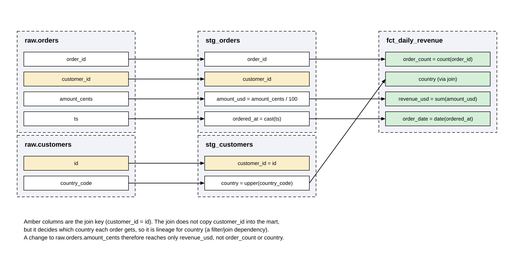

# Column-Level Lineage

## Bill of Materials

| Symbol / ID | Label | Kind | Group | Technical Notes / Metadata |
| :--- | :--- | :--- | :--- | :--- |
| `shape_2` | **order_id** | box | raw.orders | - |
| `shape_3` | **customer_id** | box | raw.orders | - |
| `shape_4` | **amount_cents** | box | raw.orders | - |
| `shape_5` | **ts** | box | raw.orders | - |
| `shape_7` | **id** | box | raw.customers | - |
| `shape_8` | **country_code** | box | raw.customers | - |
| `shape_10` | **order_id** | box | stg_orders | - |
| `shape_11` | **customer_id** | box | stg_orders | - |
| `shape_12` | **amount_usd = amount_cents / 100** | box | stg_orders | - |
| `shape_13` | **ordered_at = cast(ts)** | box | stg_orders | - |
| `shape_15` | **customer_id = id** | box | stg_customers | - |
| `shape_16` | **country = upper(country_code)** | box | stg_customers | - |
| `shape_18` | **order_count = count(order_id)** | box | fct_daily_revenue | - |
| `shape_19` | **country (via join)** | box | fct_daily_revenue | - |
| `shape_20` | **revenue_usd = sum(amount_usd)** | box | fct_daily_revenue | - |
| `shape_21` | **order_date = date(ordered_at)** | box | fct_daily_revenue | - |

## Connections

| Source | Target | Protocol / Label | Style | Routing |
| :--- | :--- | :--- | :--- | :--- |
| **order_id** (`shape_2`) | **order_id** (`shape_10`) | - | solid | direct |
| **customer_id** (`shape_3`) | **customer_id** (`shape_11`) | - | solid | direct |
| **amount_cents** (`shape_4`) | **amount_usd = amount_cents / 100** (`shape_12`) | - | solid | direct |
| **ts** (`shape_5`) | **ordered_at = cast(ts)** (`shape_13`) | - | solid | direct |
| **id** (`shape_7`) | **customer_id = id** (`shape_15`) | - | solid | direct |
| **country_code** (`shape_8`) | **country = upper(country_code)** (`shape_16`) | - | solid | direct |
| **order_id** (`shape_10`) | **order_count = count(order_id)** (`shape_18`) | - | solid | direct |
| **country = upper(country_code)** (`shape_16`) | **country (via join)** (`shape_19`) | - | solid | direct |
| **amount_usd = amount_cents / 100** (`shape_12`) | **revenue_usd = sum(amount_usd)** (`shape_20`) | - | solid | direct |
| **ordered_at = cast(ts)** (`shape_13`) | **order_date = date(ordered_at)** (`shape_21`) | - | solid | direct |
