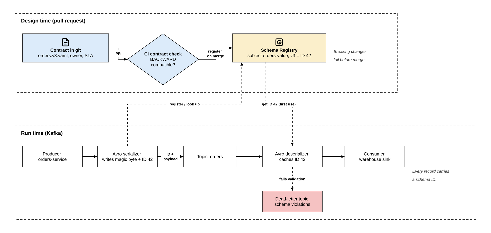

# Data Contract and Schema Registry Flow

## Bill of Materials

| Symbol / ID | Label | Kind | Group | Technical Notes / Metadata |
| :--- | :--- | :--- | :--- | :--- |
| `shape_2` | ****Contract in git** orders.v3.yaml, owner, SLA** | box | Design time (pull request) | - |
| `shape_3` | ****CI contract check** BACKWARD compatible?** | diamond | Design time (pull request) | - |
| `shape_4` | ****Schema Registry** subject orders-value, v3 = ID 42** | box | Design time (pull request) | - |
| `shape_6` | **Producer orders-service** | box | Run time (Kafka) | - |
| `shape_7` | **Avro serializer writes magic byte + ID 42** | box | Run time (Kafka) | - |
| `shape_8` | **Topic: orders** | box | Run time (Kafka) | - |
| `shape_9` | **Avro deserializer caches ID 42** | box | Run time (Kafka) | - |
| `shape_10` | **Consumer warehouse sink** | box | Run time (Kafka) | - |
| `shape_11` | **Dead-letter topic schema violations** | box | Run time (Kafka) | - |

## Connections

| Source | Target | Protocol / Label | Style | Routing |
| :--- | :--- | :--- | :--- | :--- |
| ****Contract in git** orders.v3.yaml, owner, SLA** (`shape_2`) | ****CI contract check** BACKWARD compatible?** (`shape_3`) | PR | solid | orthogonal |
| ****CI contract check** BACKWARD compatible?** (`shape_3`) | ****Schema Registry** subject orders-value, v3 = ID 42** (`shape_4`) | register on merge | solid | orthogonal |
| **Producer orders-service** (`shape_6`) | **Avro serializer writes magic byte + ID 42** (`shape_7`) | - | solid | orthogonal |
| **Avro serializer writes magic byte + ID 42** (`shape_7`) | **Topic: orders** (`shape_8`) | ID + payload | solid | orthogonal |
| **Topic: orders** (`shape_8`) | **Avro deserializer caches ID 42** (`shape_9`) | - | solid | orthogonal |
| **Avro deserializer caches ID 42** (`shape_9`) | **Consumer warehouse sink** (`shape_10`) | - | solid | orthogonal |
| **Avro deserializer caches ID 42** (`shape_9`) | **Dead-letter topic schema violations** (`shape_11`) | fails validation | dashed | orthogonal |
| ****Schema Registry** subject orders-value, v3 = ID 42** (`shape_4`) | **Avro deserializer caches ID 42** (`shape_9`) | get ID 42 (first use) | dashed | orthogonal |
| **Avro serializer writes magic byte + ID 42** (`shape_7`) | ****Schema Registry** subject orders-value, v3 = ID 42** (`shape_4`) | register / look up | dashed | orthogonal |
