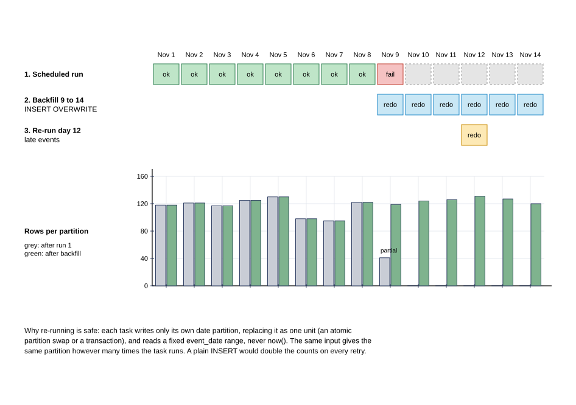

# Idempotent Backfill Timeline

## Bill of Materials

| Symbol / ID | Label | Kind | Group | Technical Notes / Metadata |
| :--- | :--- | :--- | :--- | :--- |
| `shape_16` | **ok** | box | - | - |
| `shape_17` | **ok** | box | - | - |
| `shape_18` | **ok** | box | - | - |
| `shape_19` | **ok** | box | - | - |
| `shape_20` | **ok** | box | - | - |
| `shape_21` | **ok** | box | - | - |
| `shape_22` | **ok** | box | - | - |
| `shape_23` | **ok** | box | - | - |
| `shape_24` | **fail** | box | - | - |
| `shape_25` | **** | box | - | - |
| `shape_26` | **** | box | - | - |
| `shape_27` | **** | box | - | - |
| `shape_28` | **** | box | - | - |
| `shape_29` | **** | box | - | - |
| `shape_31` | **redo** | box | - | - |
| `shape_32` | **redo** | box | - | - |
| `shape_33` | **redo** | box | - | - |
| `shape_34` | **redo** | box | - | - |
| `shape_35` | **redo** | box | - | - |
| `shape_36` | **redo** | box | - | - |
| `shape_38` | **redo** | box | - | - |

## Connections

| Source | Target | Protocol / Label | Style | Routing |
| :--- | :--- | :--- | :--- | :--- |
| **point_40** (`point_40`) | **point_41** (`point_41`) | - | solid | direct |
| **point_42** (`point_42`) | **point_43** (`point_43`) | - | solid | direct |
