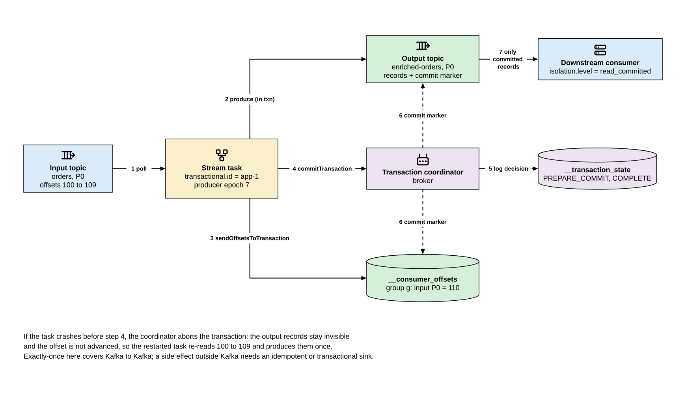

# Exactly-Once Semantics with Transactions and Offsets

## Bill of Materials

| Symbol / ID | Label | Kind | Group | Technical Notes / Metadata |
| :--- | :--- | :--- | :--- | :--- |
| `shape_1` | ****Input topic** orders, P0 offsets 100 to 109** | box | - | - |
| `shape_2` | ****Stream task** transactional.id = app-1 producer epoch 7** | box | - | - |
| `shape_3` | ****Output topic** enriched-orders, P0 records + commit marker** | box | - | - |
| `shape_4` | ****Transaction coordinator** broker** | box | - | - |
| `shape_5` | ****__transaction_state** PREPARE_COMMIT, COMPLETE** | cylinder | - | - |
| `shape_6` | ****__consumer_offsets** group g: input P0 = 110** | cylinder | - | - |
| `shape_7` | ****Downstream consumer** isolation.level = read_committed** | box | - | - |

## Connections

| Source | Target | Protocol / Label | Style | Routing |
| :--- | :--- | :--- | :--- | :--- |
| ****Input topic** orders, P0 offsets 100 to 109** (`shape_1`) | ****Stream task** transactional.id = app-1 producer epoch 7** (`shape_2`) | 1  poll | solid | orthogonal |
| ****Stream task** transactional.id = app-1 producer epoch 7** (`shape_2`) | ****Output topic** enriched-orders, P0 records + commit marker** (`shape_3`) | 2  produce (in txn) | solid | orthogonal |
| ****Stream task** transactional.id = app-1 producer epoch 7** (`shape_2`) | ****__consumer_offsets** group g: input P0 = 110** (`shape_6`) | 3  sendOffsetsToTransaction | solid | orthogonal |
| ****Stream task** transactional.id = app-1 producer epoch 7** (`shape_2`) | ****Transaction coordinator** broker** (`shape_4`) | 4  commitTransaction | solid | orthogonal |
| ****Transaction coordinator** broker** (`shape_4`) | ****__transaction_state** PREPARE_COMMIT, COMPLETE** (`shape_5`) | 5  log decision | solid | orthogonal |
| ****Transaction coordinator** broker** (`shape_4`) | ****Output topic** enriched-orders, P0 records + commit marker** (`shape_3`) | 6  commit marker | dashed | orthogonal |
| ****Transaction coordinator** broker** (`shape_4`) | ****__consumer_offsets** group g: input P0 = 110** (`shape_6`) | 6  commit marker | dashed | orthogonal |
| ****Output topic** enriched-orders, P0 records + commit marker** (`shape_3`) | ****Downstream consumer** isolation.level = read_committed** (`shape_7`) | 7  only committed records | solid | orthogonal |
