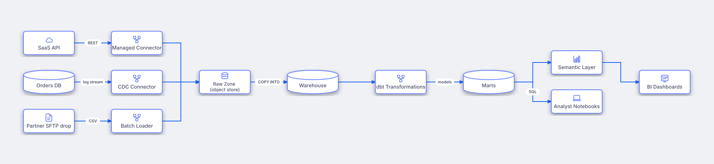

# Auto-Laid-Out Ingestion to BI

## Bill of Materials

| Symbol / ID | Label | Kind | Group | Technical Notes / Metadata |
| :--- | :--- | :--- | :--- | :--- |
| `shape_1` | **SaaS API** | box | - | - |
| `shape_2` | **Orders DB** | cylinder | - | - |
| `shape_3` | **Partner SFTP drop** | box | - | - |
| `shape_4` | **Managed Connector** | box | - | - |
| `shape_5` | **CDC Connector** | box | - | - |
| `shape_6` | **Batch Loader** | box | - | - |
| `shape_7` | **Raw Zone (object store)** | box | - | - |
| `shape_8` | **Warehouse** | cylinder | - | - |
| `shape_9` | **dbt Transformations** | box | - | - |
| `shape_10` | **Marts** | cylinder | - | - |
| `shape_11` | **Semantic Layer** | box | - | - |
| `shape_12` | **BI Dashboards** | box | - | - |
| `shape_13` | **Analyst Notebooks** | box | - | - |

## Connections

| Source | Target | Protocol / Label | Style | Routing |
| :--- | :--- | :--- | :--- | :--- |
| **SaaS API** (`shape_1`) | **Managed Connector** (`shape_4`) | REST | solid | orthogonal |
| **Orders DB** (`shape_2`) | **CDC Connector** (`shape_5`) | log stream | solid | orthogonal |
| **Partner SFTP drop** (`shape_3`) | **Batch Loader** (`shape_6`) | CSV | solid | orthogonal |
| **Managed Connector** (`shape_4`) | **Raw Zone (object store)** (`shape_7`) | - | solid | orthogonal |
| **CDC Connector** (`shape_5`) | **Raw Zone (object store)** (`shape_7`) | - | solid | orthogonal |
| **Batch Loader** (`shape_6`) | **Raw Zone (object store)** (`shape_7`) | - | solid | orthogonal |
| **Raw Zone (object store)** (`shape_7`) | **Warehouse** (`shape_8`) | COPY INTO | solid | orthogonal |
| **Warehouse** (`shape_8`) | **dbt Transformations** (`shape_9`) | - | solid | orthogonal |
| **dbt Transformations** (`shape_9`) | **Marts** (`shape_10`) | models | solid | orthogonal |
| **Marts** (`shape_10`) | **Semantic Layer** (`shape_11`) | - | solid | orthogonal |
| **Semantic Layer** (`shape_11`) | **BI Dashboards** (`shape_12`) | - | solid | orthogonal |
| **Marts** (`shape_10`) | **Analyst Notebooks** (`shape_13`) | SQL | solid | orthogonal |
