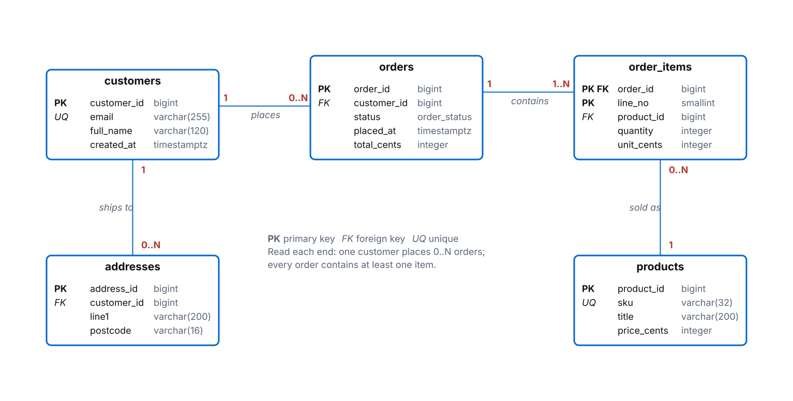

# Online Store Entity-Relationship Model

## Bill of Materials

| Symbol / ID | Label | Kind | Group | Technical Notes / Metadata |
| :--- | :--- | :--- | :--- | :--- |
| `tbl_customers` | ****customers**** | box | - | - |
| `tbl_orders` | ****orders**** | box | - | - |
| `tbl_order_items` | ****order_items**** | box | - | - |
| `tbl_addresses` | ****addresses**** | box | - | - |
| `tbl_products` | ****products**** | box | - | - |

## Connections

| Source | Target | Protocol / Label | Style | Routing |
| :--- | :--- | :--- | :--- | :--- |
| ****customers**** (`tbl_customers`) | ****orders**** (`tbl_orders`) | - | solid | orthogonal |
| ****orders**** (`tbl_orders`) | ****order_items**** (`tbl_order_items`) | - | solid | orthogonal |
| ****order_items**** (`tbl_order_items`) | ****products**** (`tbl_products`) | - | solid | orthogonal |
| ****customers**** (`tbl_customers`) | ****addresses**** (`tbl_addresses`) | - | solid | orthogonal |
