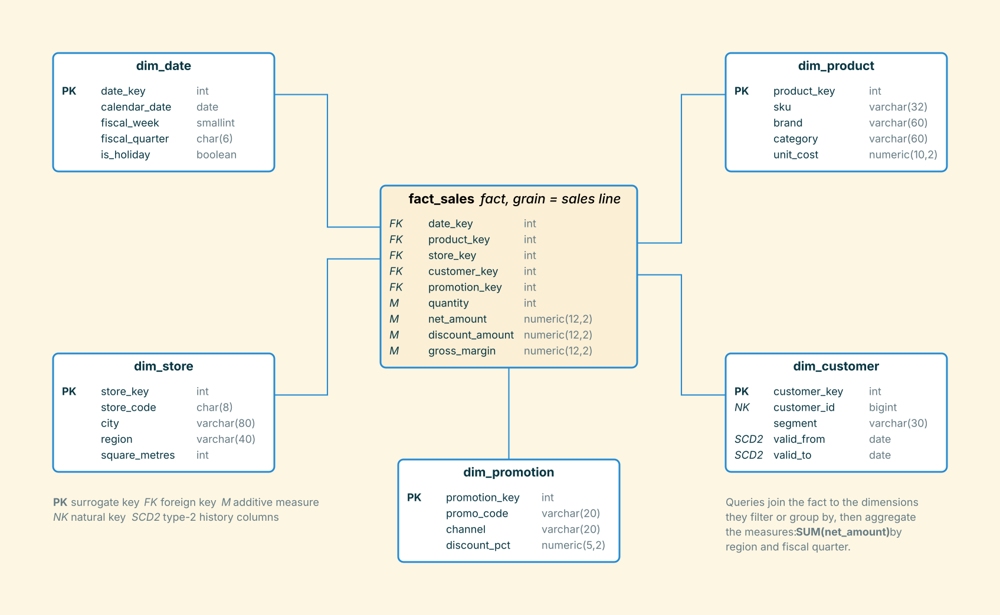

# Retail Sales Star Schema Data Warehouse

## Bill of Materials

| Symbol / ID | Label | Kind | Group | Technical Notes / Metadata |
| :--- | :--- | :--- | :--- | :--- |
| `tbl_dim_date` | ****dim_date**** | box | - | - |
| `tbl_dim_product` | ****dim_product**** | box | - | - |
| `tbl_fact_sales` | ****fact_sales** *fact, grain = sales line*** | box | - | - |
| `tbl_dim_store` | ****dim_store**** | box | - | - |
| `tbl_dim_customer` | ****dim_customer**** | box | - | - |
| `tbl_dim_promotion` | ****dim_promotion**** | box | - | - |

## Connections

| Source | Target | Protocol / Label | Style | Routing |
| :--- | :--- | :--- | :--- | :--- |
| ****dim_date**** (`tbl_dim_date`) | ****fact_sales** *fact, grain = sales line*** (`tbl_fact_sales`) | - | solid | orthogonal |
| ****dim_store**** (`tbl_dim_store`) | ****fact_sales** *fact, grain = sales line*** (`tbl_fact_sales`) | - | solid | orthogonal |
| ****dim_product**** (`tbl_dim_product`) | ****fact_sales** *fact, grain = sales line*** (`tbl_fact_sales`) | - | solid | orthogonal |
| ****dim_customer**** (`tbl_dim_customer`) | ****fact_sales** *fact, grain = sales line*** (`tbl_fact_sales`) | - | solid | orthogonal |
| ****fact_sales** *fact, grain = sales line*** (`tbl_fact_sales`) | ****dim_promotion**** (`tbl_dim_promotion`) | - | solid | orthogonal |
