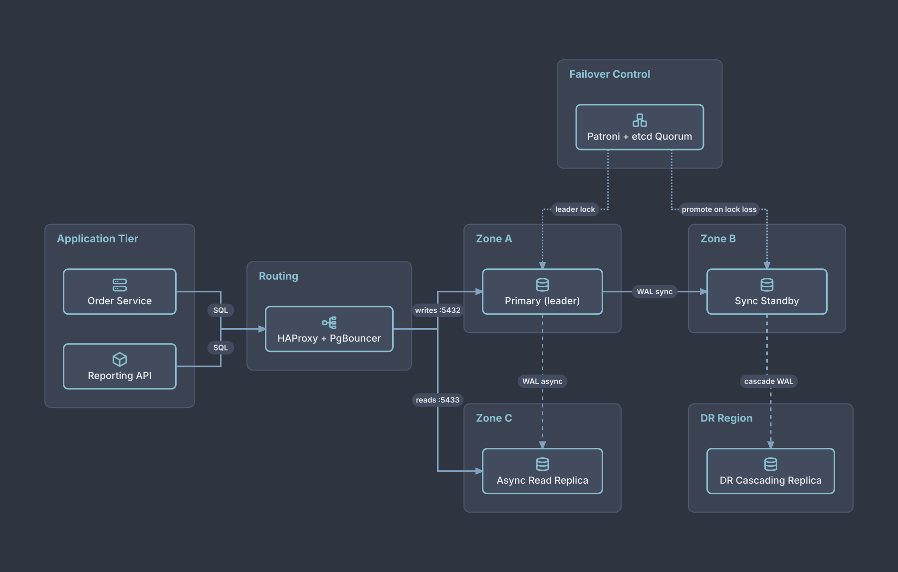

# PostgreSQL Primary/Replica Replication with Automatic Failover

## Bill of Materials

| Symbol / ID | Label | Kind | Group | Technical Notes / Metadata |
| :--- | :--- | :--- | :--- | :--- |
| `app` | **Order Service** | box | Application Tier | pool: 20 conns / pod |
| `reports` | **Reporting API** | box | Application Tier | mode: read-only |
| `proxy` | **HAProxy + PgBouncer** | box | Routing | ports: :5432 rw / :5433 ro |
| `primary` | **Primary (leader)** | box | Zone A | role: read-write |
| `standby` | **Sync Standby** | box | Zone B | synchronous_commit: remote_apply |
| `replica` | **Async Read Replica** | box | Zone C | hot_standby: on |
| `dcs` | **Patroni + etcd Quorum** | box | Failover Control | ttl: 30 s leader lock |
| `dr` | **DR Cascading Replica** | box | DR Region | lag_target: < 60 s |

## Connections

| Source | Target | Protocol / Label | Style | Routing |
| :--- | :--- | :--- | :--- | :--- |
| **Order Service** (`app`) | **HAProxy + PgBouncer** (`proxy`) | SQL | solid | orthogonal |
| **Reporting API** (`reports`) | **HAProxy + PgBouncer** (`proxy`) | SQL | solid | orthogonal |
| **HAProxy + PgBouncer** (`proxy`) | **Primary (leader)** (`primary`) | writes :5432 | solid | orthogonal |
| **HAProxy + PgBouncer** (`proxy`) | **Async Read Replica** (`replica`) | reads :5433 | solid | orthogonal |
| **Primary (leader)** (`primary`) | **Sync Standby** (`standby`) | WAL sync | solid | orthogonal |
| **Primary (leader)** (`primary`) | **Async Read Replica** (`replica`) | WAL async | dashed | orthogonal |
| **Sync Standby** (`standby`) | **DR Cascading Replica** (`dr`) | cascade WAL | dashed | orthogonal |
| **Patroni + etcd Quorum** (`dcs`) | **Primary (leader)** (`primary`) | leader lock | dotted | orthogonal |
| **Patroni + etcd Quorum** (`dcs`) | **Sync Standby** (`standby`) | promote on lock loss | dotted | orthogonal |
