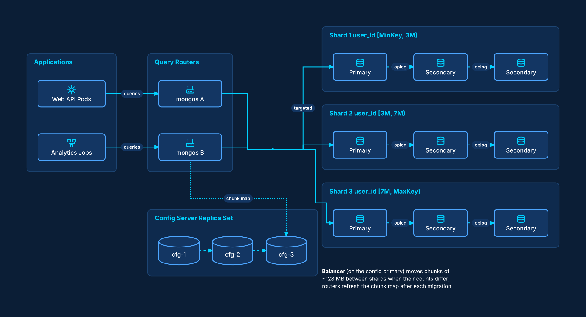

# Range-Sharded Document Database Cluster

## Bill of Materials

| Symbol / ID | Label | Kind | Group | Technical Notes / Metadata |
| :--- | :--- | :--- | :--- | :--- |
| `web` | **Web API Pods** | box | Applications | driver: v6 driver |
| `batch` | **Analytics Jobs** | box | Applications | read_pref: secondary |
| `mongos_a` | **mongos A** | box | Query Routers | state: stateless |
| `mongos_b` | **mongos B** | box | Query Routers | state: stateless |
| `cfg1` | **cfg-1** | cylinder | Config Server Replica Set | role: primary |
| `cfg2` | **cfg-2** | cylinder | Config Server Replica Set | role: secondary |
| `cfg3` | **cfg-3** | cylinder | Config Server Replica Set | role: secondary |
| `s1p` | **Primary** | box | Shard 1   user_id [MinKey, 3M) | shard: rs1 |
| `s1s1` | **Secondary** | box | Shard 1   user_id [MinKey, 3M) | shard: rs1 |
| `s1s2` | **Secondary** | box | Shard 1   user_id [MinKey, 3M) | shard: rs1 |
| `s2p` | **Primary** | box | Shard 2   user_id [3M, 7M) | shard: rs2 |
| `s2s1` | **Secondary** | box | Shard 2   user_id [3M, 7M) | shard: rs2 |
| `s2s2` | **Secondary** | box | Shard 2   user_id [3M, 7M) | shard: rs2 |
| `s3p` | **Primary** | box | Shard 3   user_id [7M, MaxKey) | shard: rs3 |
| `s3s1` | **Secondary** | box | Shard 3   user_id [7M, MaxKey) | shard: rs3 |
| `s3s2` | **Secondary** | box | Shard 3   user_id [7M, MaxKey) | shard: rs3 |

## Connections

| Source | Target | Protocol / Label | Style | Routing |
| :--- | :--- | :--- | :--- | :--- |
| **Web API Pods** (`web`) | **mongos A** (`mongos_a`) | queries | solid | orthogonal |
| **Analytics Jobs** (`batch`) | **mongos B** (`mongos_b`) | queries | solid | orthogonal |
| **mongos A** (`mongos_a`) | **point_7** (`point_7`) | - | solid | orthogonal |
| **mongos B** (`mongos_b`) | **point_7** (`point_7`) | - | solid | orthogonal |
| **point_7** (`point_7`) | **Primary** (`s1p`) | targeted | solid | orthogonal |
| **Primary** (`s1p`) | **Secondary** (`s1s1`) | oplog | dashed | orthogonal |
| **Secondary** (`s1s1`) | **Secondary** (`s1s2`) | oplog | dashed | orthogonal |
| **point_7** (`point_7`) | **Primary** (`s2p`) | - | solid | orthogonal |
| **Primary** (`s2p`) | **Secondary** (`s2s1`) | oplog | dashed | orthogonal |
| **Secondary** (`s2s1`) | **Secondary** (`s2s2`) | oplog | dashed | orthogonal |
| **point_7** (`point_7`) | **Primary** (`s3p`) | - | solid | orthogonal |
| **Primary** (`s3p`) | **Secondary** (`s3s1`) | oplog | dashed | orthogonal |
| **Secondary** (`s3s1`) | **Secondary** (`s3s2`) | oplog | dashed | orthogonal |
| **mongos B** (`mongos_b`) | **cfg-3** (`cfg3`) | chunk map | dotted | orthogonal |
| **cfg-1** (`cfg1`) | **cfg-2** (`cfg2`) | - | dashed | orthogonal |
| **cfg-2** (`cfg2`) | **cfg-3** (`cfg3`) | - | dashed | orthogonal |
