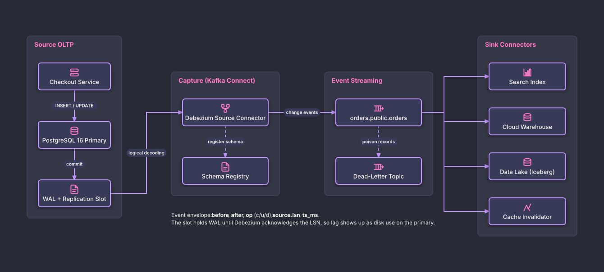

# Change Data Capture Pipeline from WAL to Kafka

## Bill of Materials

| Symbol / ID | Label | Kind | Group | Technical Notes / Metadata |
| :--- | :--- | :--- | :--- | :--- |
| `app` | **Checkout Service** | box | Source OLTP | lang: Go |
| `db` | **PostgreSQL 16 Primary** | box | Source OLTP | wal_level: logical |
| `wal` | **WAL + Replication Slot** | box | Source OLTP | plugin: pgoutput |
| `debezium` | **Debezium Source Connector** | box | Capture (Kafka Connect) | snapshot: initial, then streaming |
| `registry` | **Schema Registry** | box | Capture (Kafka Connect) | compatibility: BACKWARD |
| `topic` | **orders.public.orders** | box | Event Streaming | partitions: 12, key = order_id |
| `dlq` | **Dead-Letter Topic** | box | Event Streaming | retention: 14 d |
| `search` | **Search Index** | box | Sink Connectors | mode: upsert by key |
| `dwh` | **Cloud Warehouse** | box | Sink Connectors | load: micro-batch 1 min |
| `lake` | **Data Lake (Iceberg)** | box | Sink Connectors | format: Parquet |
| `cache` | **Cache Invalidator** | box | Sink Connectors | target: Redis |

## Connections

| Source | Target | Protocol / Label | Style | Routing |
| :--- | :--- | :--- | :--- | :--- |
| **Checkout Service** (`app`) | **PostgreSQL 16 Primary** (`db`) | INSERT / UPDATE | solid | orthogonal |
| **PostgreSQL 16 Primary** (`db`) | **WAL + Replication Slot** (`wal`) | commit | solid | orthogonal |
| **WAL + Replication Slot** (`wal`) | **Debezium Source Connector** (`debezium`) | logical decoding | solid | orthogonal |
| **Debezium Source Connector** (`debezium`) | **Schema Registry** (`registry`) | register schema | dashed | orthogonal |
| **Debezium Source Connector** (`debezium`) | **orders.public.orders** (`topic`) | change events | solid | orthogonal |
| **orders.public.orders** (`topic`) | **Search Index** (`search`) | - | solid | orthogonal |
| **orders.public.orders** (`topic`) | **Cloud Warehouse** (`dwh`) | - | solid | orthogonal |
| **orders.public.orders** (`topic`) | **Data Lake (Iceberg)** (`lake`) | - | solid | orthogonal |
| **orders.public.orders** (`topic`) | **Cache Invalidator** (`cache`) | - | solid | orthogonal |
| **orders.public.orders** (`topic`) | **Dead-Letter Topic** (`dlq`) | poison records | dashed | orthogonal |
