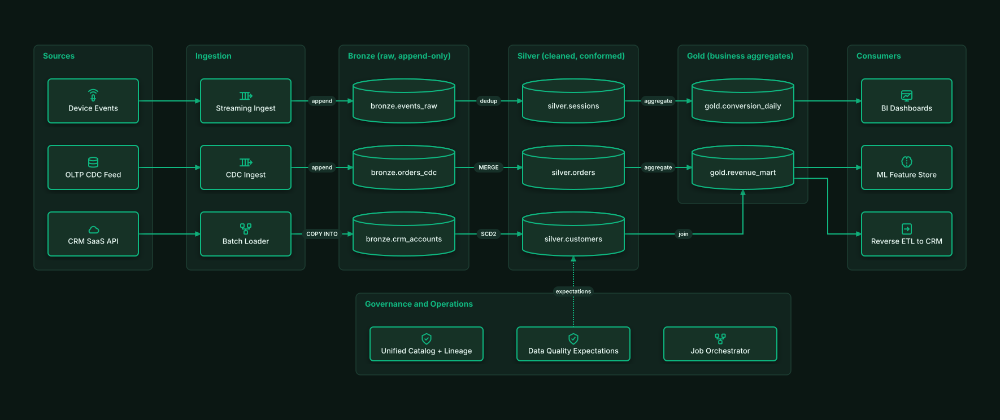

# Lakehouse Medallion Architecture, Bronze to Gold

## Bill of Materials

| Symbol / ID | Label | Kind | Group | Technical Notes / Metadata |
| :--- | :--- | :--- | :--- | :--- |
| `iot` | **Device Events** | box | Sources | rate: 40k msg/s |
| `oltp` | **OLTP CDC Feed** | box | Sources | via: Debezium |
| `saas` | **CRM SaaS API** | box | Sources | cadence: hourly |
| `stream` | **Streaming Ingest** | box | Ingestion | trigger: continuous |
| `cdc` | **CDC Ingest** | box | Ingestion | trigger: continuous |
| `batch` | **Batch Loader** | box | Ingestion | trigger: hourly |
| `b_events` | **bronze.events_raw** | cylinder | Bronze  (raw, append-only) | format: Delta |
| `b_orders` | **bronze.orders_cdc** | cylinder | Bronze  (raw, append-only) | format: Delta |
| `b_crm` | **bronze.crm_accounts** | cylinder | Bronze  (raw, append-only) | format: JSON in Delta |
| `s_events` | **silver.sessions** | cylinder | Silver  (cleaned, conformed) | dedup: event_id |
| `s_orders` | **silver.orders** | cylinder | Silver  (cleaned, conformed) | merge: MERGE on order_id |
| `s_customers` | **silver.customers** | cylinder | Silver  (cleaned, conformed) | scd: type 2 |
| `g_funnel` | **gold.conversion_daily** | cylinder | Gold  (business aggregates) | grain: day x channel |
| `g_revenue` | **gold.revenue_mart** | cylinder | Gold  (business aggregates) | grain: order line |
| `bi` | **BI Dashboards** | box | Consumers | tool: SQL warehouse |
| `ml` | **ML Feature Store** | box | Consumers | refresh: daily |
| `retl` | **Reverse ETL to CRM** | box | Consumers | sync: 15 min |
| `catalog` | **Unified Catalog + Lineage** | box | Governance and Operations | scope: all layers |
| `quality` | **Data Quality Expectations** | box | Governance and Operations | on_fail: quarantine row |
| `orch` | **Job Orchestrator** | box | Governance and Operations | sla: gold by 06:00 |

## Connections

| Source | Target | Protocol / Label | Style | Routing |
| :--- | :--- | :--- | :--- | :--- |
| **Device Events** (`iot`) | **Streaming Ingest** (`stream`) | - | solid | orthogonal |
| **OLTP CDC Feed** (`oltp`) | **CDC Ingest** (`cdc`) | - | solid | orthogonal |
| **CRM SaaS API** (`saas`) | **Batch Loader** (`batch`) | - | solid | orthogonal |
| **Streaming Ingest** (`stream`) | **bronze.events_raw** (`b_events`) | append | solid | orthogonal |
| **CDC Ingest** (`cdc`) | **bronze.orders_cdc** (`b_orders`) | append | solid | orthogonal |
| **Batch Loader** (`batch`) | **bronze.crm_accounts** (`b_crm`) | COPY INTO | solid | orthogonal |
| **bronze.events_raw** (`b_events`) | **silver.sessions** (`s_events`) | dedup | solid | orthogonal |
| **bronze.orders_cdc** (`b_orders`) | **silver.orders** (`s_orders`) | MERGE | solid | orthogonal |
| **bronze.crm_accounts** (`b_crm`) | **silver.customers** (`s_customers`) | SCD2 | solid | orthogonal |
| **silver.sessions** (`s_events`) | **gold.conversion_daily** (`g_funnel`) | aggregate | solid | orthogonal |
| **silver.orders** (`s_orders`) | **gold.revenue_mart** (`g_revenue`) | aggregate | solid | orthogonal |
| **silver.customers** (`s_customers`) | **gold.revenue_mart** (`g_revenue`) | join | solid | orthogonal |
| **gold.conversion_daily** (`g_funnel`) | **BI Dashboards** (`bi`) | - | solid | orthogonal |
| **gold.revenue_mart** (`g_revenue`) | **ML Feature Store** (`ml`) | - | solid | orthogonal |
| **gold.revenue_mart** (`g_revenue`) | **Reverse ETL to CRM** (`retl`) | - | solid | orthogonal |
| **Data Quality Expectations** (`quality`) | **silver.customers** (`s_customers`) | expectations | dotted | orthogonal |
