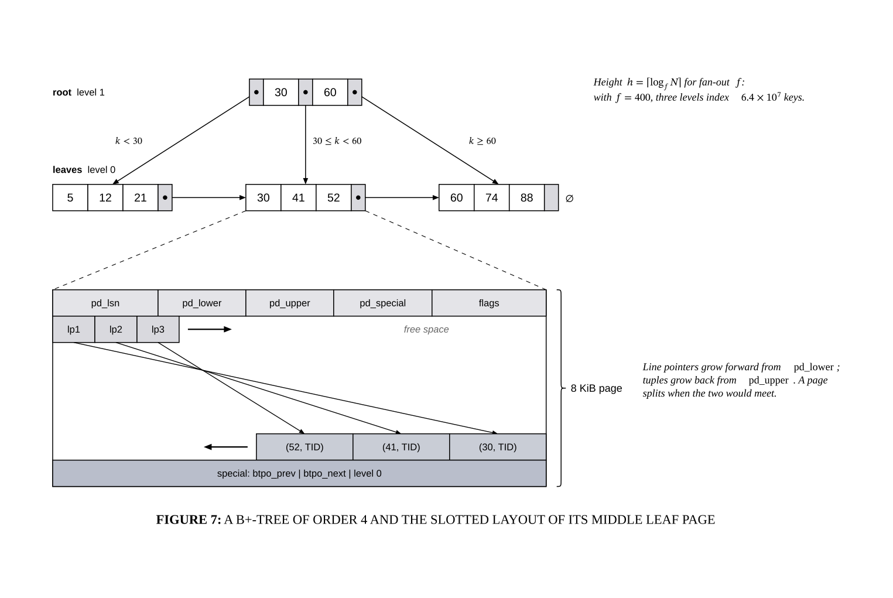

# B+-Tree Index Page Structure

## Bill of Materials

| Symbol / ID | Label | Kind | Group | Technical Notes / Metadata |
| :--- | :--- | :--- | :--- | :--- |
| `shape_1` | **** | box | - | - |
| `shape_2` | **30** | box | - | - |
| `shape_3` | **** | box | - | - |
| `shape_4` | **60** | box | - | - |
| `shape_5` | **** | box | - | - |
| `shape_6` | **5** | box | - | - |
| `shape_7` | **12** | box | - | - |
| `shape_8` | **21** | box | - | - |
| `shape_9` | **** | box | - | - |
| `shape_10` | **30** | box | - | - |
| `shape_11` | **41** | box | - | - |
| `shape_12` | **52** | box | - | - |
| `shape_13` | **** | box | - | - |
| `shape_14` | **60** | box | - | - |
| `shape_15` | **74** | box | - | - |
| `shape_16` | **88** | box | - | - |
| `shape_17` | **** | box | - | - |
| `shape_40` | **** | box | - | - |
| `shape_41` | **pd_lsn** | box | - | - |
| `shape_42` | **pd_lower** | box | - | - |
| `shape_43` | **pd_upper** | box | - | - |
| `shape_44` | **pd_special** | box | - | - |
| `shape_45` | **flags** | box | - | - |
| `shape_46` | **lp1** | box | - | - |
| `shape_47` | **lp2** | box | - | - |
| `shape_48` | **lp3** | box | - | - |
| `shape_50` | **(52, TID)** | box | - | - |
| `shape_51` | **(41, TID)** | box | - | - |
| `shape_52` | **(30, TID)** | box | - | - |
| `shape_53` | **special: btpo_prev \| btpo_next \| level 0** | box | - | - |

## Connections

| Source | Target | Protocol / Label | Style | Routing |
| :--- | :--- | :--- | :--- | :--- |
| **point_19** (`point_19`) | **point_20** (`point_20`) | - | solid | direct |
| **point_22** (`point_22`) | **point_23** (`point_23`) | - | solid | direct |
| **point_25** (`point_25`) | **point_26** (`point_26`) | - | solid | direct |
| **point_28** (`point_28`) | **point_29** (`point_29`) | - | solid | direct |
| **point_31** (`point_31`) | **point_32** (`point_32`) | - | solid | direct |
| **lp1** (`shape_46`) | **(30, TID)** (`shape_52`) | - | solid | direct |
| **lp2** (`shape_47`) | **(41, TID)** (`shape_51`) | - | solid | direct |
| **lp3** (`shape_48`) | **(52, TID)** (`shape_50`) | - | solid | direct |
| **point_54** (`point_54`) | **point_55** (`point_55`) | - | solid | direct |
| **point_56** (`point_56`) | **point_57** (`point_57`) | - | solid | direct |
| **point_58** (`point_58`) | **point_59** (`point_59`) | - | dashed | direct |
| **point_60** (`point_60`) | **point_61** (`point_61`) | - | dashed | direct |
