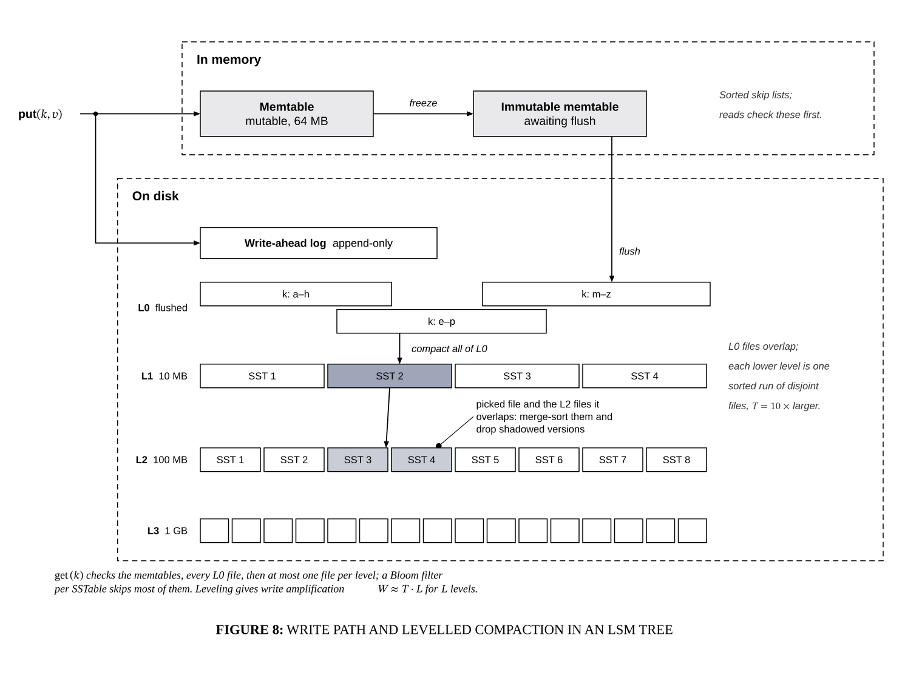

# LSM-Tree Levelled Compaction

## Bill of Materials

| Symbol / ID | Label | Kind | Group | Technical Notes / Metadata |
| :--- | :--- | :--- | :--- | :--- |
| `shape_2` | ****Memtable** mutable, 64 MB** | box | In memory | - |
| `shape_3` | ****Immutable memtable** awaiting flush** | box | In memory | - |
| `shape_6` | ****Write-ahead log**  append-only** | box | On disk | - |
| `shape_7` | **k: a–h** | box | On disk | - |
| `shape_8` | **k: e–p** | box | On disk | - |
| `shape_9` | **k: m–z** | box | On disk | - |
| `shape_10` | **SST 1** | box | On disk | - |
| `shape_11` | **SST 2** | box | On disk | - |
| `shape_12` | **SST 3** | box | On disk | - |
| `shape_13` | **SST 4** | box | On disk | - |
| `shape_14` | **SST 1** | box | On disk | - |
| `shape_15` | **SST 2** | box | On disk | - |
| `shape_16` | **SST 3** | box | On disk | - |
| `shape_17` | **SST 4** | box | On disk | - |
| `shape_18` | **SST 5** | box | On disk | - |
| `shape_19` | **SST 6** | box | On disk | - |
| `shape_20` | **SST 7** | box | On disk | - |
| `shape_21` | **SST 8** | box | On disk | - |
| `shape_22` | **** | box | On disk | - |
| `shape_23` | **** | box | On disk | - |
| `shape_24` | **** | box | On disk | - |
| `shape_25` | **** | box | On disk | - |
| `shape_26` | **** | box | On disk | - |
| `shape_27` | **** | box | On disk | - |
| `shape_28` | **** | box | On disk | - |
| `shape_29` | **** | box | On disk | - |
| `shape_30` | **** | box | On disk | - |
| `shape_31` | **** | box | On disk | - |
| `shape_32` | **** | box | On disk | - |
| `shape_33` | **** | box | On disk | - |
| `shape_34` | **** | box | On disk | - |
| `shape_35` | **** | box | On disk | - |
| `shape_36` | **** | box | On disk | - |
| `shape_37` | **** | box | On disk | - |

## Connections

| Source | Target | Protocol / Label | Style | Routing |
| :--- | :--- | :--- | :--- | :--- |
| **picked file and the L2 files it overlaps: merge-sort them and drop shadowed versions** (`text_44`) | **SST 4** (`shape_17`) | - | solid | direct |
| **point_47** (`point_47`) | **point_46** (`point_46`) | - | solid | direct |
| **point_46** (`point_46`) | ****Memtable** mutable, 64 MB** (`shape_2`) | - | solid | direct |
| **point_46** (`point_46`) | ****Write-ahead log**  append-only** (`shape_6`) | - | solid | direct |
| ****Memtable** mutable, 64 MB** (`shape_2`) | ****Immutable memtable** awaiting flush** (`shape_3`) | - | solid | direct |
| ****Immutable memtable** awaiting flush** (`shape_3`) | **k: m–z** (`shape_9`) | - | solid | direct |
| **k: e–p** (`shape_8`) | **SST 2** (`shape_11`) | - | solid | direct |
| **SST 2** (`shape_11`) | **SST 3** (`shape_16`) | - | solid | direct |
