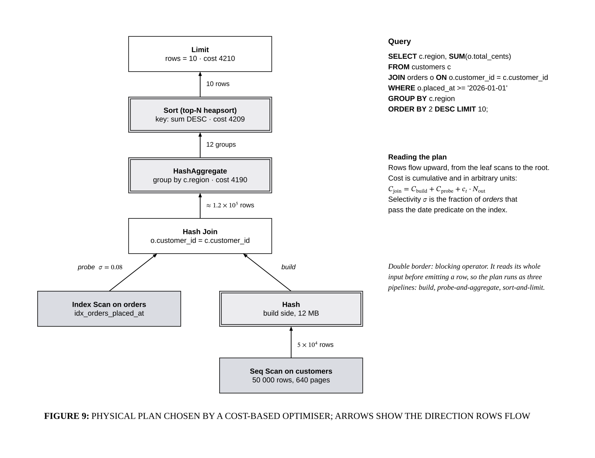

# Physical Query Plan Tree for a Join and Top-N

## Bill of Materials

| Symbol / ID | Label | Kind | Group | Technical Notes / Metadata |
| :--- | :--- | :--- | :--- | :--- |
| `shape_1` | ****Limit** rows = 10 · cost 4210** | box | - | - |
| `shape_2` | ****Sort  (top-N heapsort)** key: sum DESC · cost 4209** | box | - | - |
| `shape_3` | ****HashAggregate** group by c.region · cost 4190** | box | - | - |
| `shape_4` | ****Hash Join** o.customer_id = c.customer_id** | box | - | - |
| `shape_5` | ****Index Scan on orders** idx_orders_placed_at** | box | - | - |
| `shape_6` | ****Hash** build side, 12 MB** | box | - | - |
| `shape_7` | ****Seq Scan on customers** 50 000 rows, 640 pages** | box | - | - |

## Connections

| Source | Target | Protocol / Label | Style | Routing |
| :--- | :--- | :--- | :--- | :--- |
| ****Sort  (top-N heapsort)** key: sum DESC · cost 4209** (`shape_2`) | ****Limit** rows = 10 · cost 4210** (`shape_1`) | - | solid | direct |
| ****HashAggregate** group by c.region · cost 4190** (`shape_3`) | ****Sort  (top-N heapsort)** key: sum DESC · cost 4209** (`shape_2`) | - | solid | direct |
| ****Hash Join** o.customer_id = c.customer_id** (`shape_4`) | ****HashAggregate** group by c.region · cost 4190** (`shape_3`) | - | solid | direct |
| ****Index Scan on orders** idx_orders_placed_at** (`shape_5`) | ****Hash Join** o.customer_id = c.customer_id** (`shape_4`) | - | solid | direct |
| ****Hash** build side, 12 MB** (`shape_6`) | ****Hash Join** o.customer_id = c.customer_id** (`shape_4`) | - | solid | direct |
| ****Seq Scan on customers** 50 000 rows, 640 pages** (`shape_7`) | ****Hash** build side, 12 MB** (`shape_6`) | - | solid | direct |
