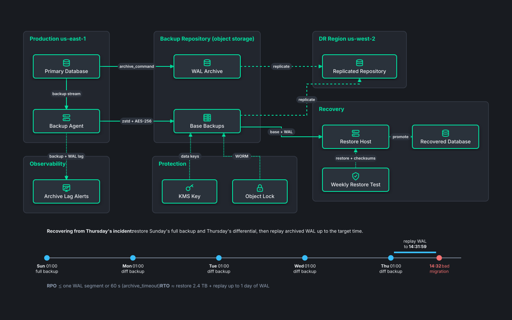

# Backup and Point-in-Time Recovery Strategy

## Bill of Materials

| Symbol / ID | Label | Kind | Group | Technical Notes / Metadata |
| :--- | :--- | :--- | :--- | :--- |
| `primary` | **Primary Database** | box | Production  us-east-1 | size: 2.4 TB |
| `agent` | **Backup Agent** | box | Production  us-east-1 | tool: pgBackRest |
| `wal` | **WAL Archive** | box | Backup Repository  (object storage) | segment: 16 MB |
| `base` | **Base Backups** | box | Backup Repository  (object storage) | schedule: full Sun, diff daily |
| `copy` | **Replicated Repository** | box | DR Region  us-west-2 | lag: < 15 min |
| `kms` | **KMS Key** | box | Protection | rotation: yearly |
| `lock` | **Object Lock** | box | Protection | retention: 35 days |
| `restore` | **Restore Host** | box | Recovery | target: recovery_target_time |
| `recovered` | **Recovered Database** | box | Recovery | - |
| `verify` | **Weekly Restore Test** | box | Recovery | - |
| `monitor` | **Archive Lag Alerts** | box | Observability | alert: WAL lag > 5 min |
| `shape_8` | **** | box | - | - |
| `shape_10` | **** | box | - | - |
| `shape_12` | **** | box | - | - |
| `shape_14` | **** | box | - | - |
| `shape_16` | **** | box | - | - |
| `shape_18` | **** | box | - | - |

## Connections

| Source | Target | Protocol / Label | Style | Routing |
| :--- | :--- | :--- | :--- | :--- |
| **Primary Database** (`primary`) | **WAL Archive** (`wal`) | archive_command | solid | orthogonal |
| **Primary Database** (`primary`) | **Backup Agent** (`agent`) | backup stream | solid | orthogonal |
| **Backup Agent** (`agent`) | **Base Backups** (`base`) | zstd + AES-256 | solid | orthogonal |
| **WAL Archive** (`wal`) | **Replicated Repository** (`copy`) | replicate | dashed | orthogonal |
| **Base Backups** (`base`) | **Replicated Repository** (`copy`) | replicate | dashed | orthogonal |
| **KMS Key** (`kms`) | **Base Backups** (`base`) | data keys | dotted | orthogonal |
| **Object Lock** (`lock`) | **Base Backups** (`base`) | WORM | dotted | orthogonal |
| **Base Backups** (`base`) | **Restore Host** (`restore`) | base + WAL | solid | orthogonal |
| **Restore Host** (`restore`) | **Recovered Database** (`recovered`) | promote | solid | orthogonal |
| **Weekly Restore Test** (`verify`) | **Restore Host** (`restore`) | restore + checksums | dotted | orthogonal |
| **Backup Agent** (`agent`) | **Archive Lag Alerts** (`monitor`) | backup + WAL lag | dotted | orthogonal |
