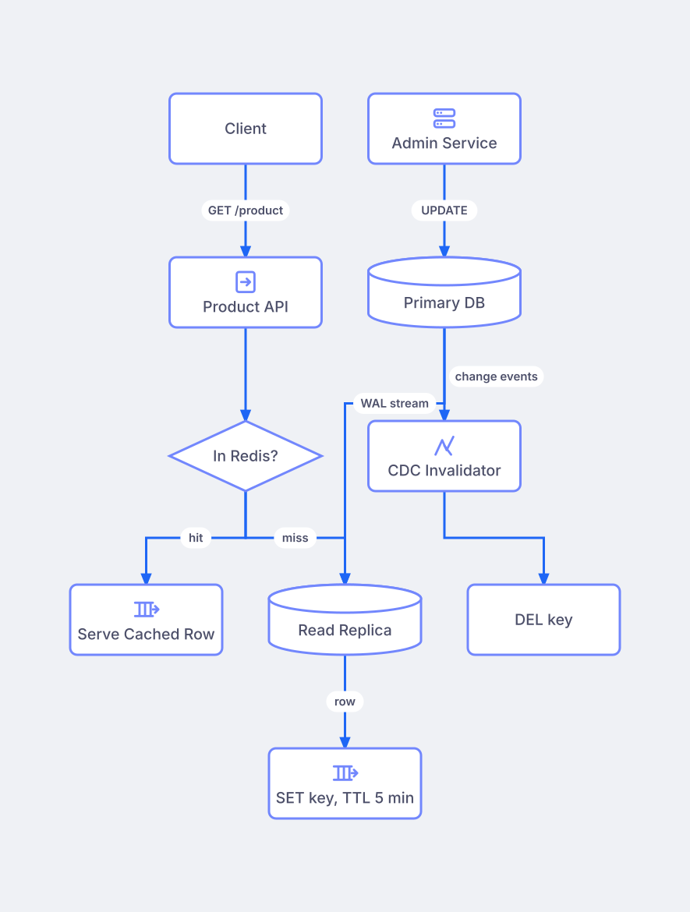

# Auto-Laid-Out Cache-Aside Read and Write Path

## Bill of Materials

| Symbol / ID | Label | Kind | Group | Technical Notes / Metadata |
| :--- | :--- | :--- | :--- | :--- |
| `shape_1` | **Client** | box | - | - |
| `shape_2` | **Product API** | box | - | - |
| `shape_3` | **In Redis?** | diamond | - | - |
| `shape_4` | **Serve Cached Row** | box | - | - |
| `shape_5` | **Read Replica** | cylinder | - | - |
| `shape_6` | **SET key, TTL 5 min** | box | - | - |
| `shape_7` | **Admin Service** | box | - | - |
| `shape_8` | **Primary DB** | cylinder | - | - |
| `shape_9` | **CDC Invalidator** | box | - | - |
| `shape_10` | **DEL key** | box | - | - |

## Connections

| Source | Target | Protocol / Label | Style | Routing |
| :--- | :--- | :--- | :--- | :--- |
| **Client** (`shape_1`) | **Product API** (`shape_2`) | GET /product | solid | orthogonal |
| **Product API** (`shape_2`) | **In Redis?** (`shape_3`) | - | solid | orthogonal |
| **In Redis?** (`shape_3`) | **Serve Cached Row** (`shape_4`) | hit | solid | orthogonal |
| **In Redis?** (`shape_3`) | **Read Replica** (`shape_5`) | miss | solid | orthogonal |
| **Read Replica** (`shape_5`) | **SET key, TTL 5 min** (`shape_6`) | row | solid | orthogonal |
| **Admin Service** (`shape_7`) | **Primary DB** (`shape_8`) | UPDATE | solid | orthogonal |
| **Primary DB** (`shape_8`) | **Read Replica** (`shape_5`) | WAL stream | solid | orthogonal |
| **Primary DB** (`shape_8`) | **CDC Invalidator** (`shape_9`) | change events | solid | orthogonal |
| **CDC Invalidator** (`shape_9`) | **DEL key** (`shape_10`) | - | solid | orthogonal |
