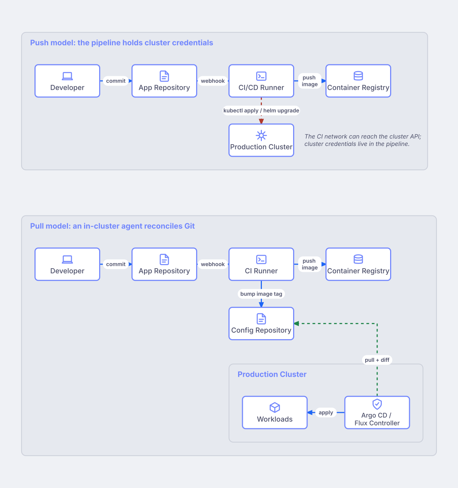

# GitOps: Push-Based CD vs Pull-Based Reconciliation (Argo CD / Flux)

## Bill of Materials

| Symbol / ID | Label | Kind | Group | Technical Notes / Metadata |
| :--- | :--- | :--- | :--- | :--- |
| `p_dev` | **Developer** | box | Push model: the pipeline holds cluster credentials | action: git push |
| `p_repo` | **App Repository** | box | Push model: the pipeline holds cluster credentials | content: source + manifests |
| `p_ci` | **CI/CD Runner** | box | Push model: the pipeline holds cluster credentials | steps: build, test, deploy |
| `p_reg` | **Container Registry** | box | Push model: the pipeline holds cluster credentials | artifact: image:sha |
| `p_cluster` | **Production Cluster** | box | Push model: the pipeline holds cluster credentials | api: kube-apiserver |
| `q_dev` | **Developer** | box | Pull model: an in-cluster agent reconciles Git | action: git push / PR |
| `q_app` | **App Repository** | box | Pull model: an in-cluster agent reconciles Git | content: source code |
| `q_ci` | **CI Runner** | box | Pull model: an in-cluster agent reconciles Git | steps: build, test, scan |
| `q_reg` | **Container Registry** | box | Pull model: an in-cluster agent reconciles Git | artifact: image:sha |
| `q_cfg` | **Config Repository** | box | Pull model: an in-cluster agent reconciles Git | content: desired state |
| `q_agent` | **Argo CD / Flux Controller** | box | Production Cluster | loop: reconcile 3 min |
| `q_work` | **Workloads** | box | Production Cluster | state: live state |

## Connections

| Source | Target | Protocol / Label | Style | Routing |
| :--- | :--- | :--- | :--- | :--- |
| **Developer** (`p_dev`) | **App Repository** (`p_repo`) | commit | solid | orthogonal |
| **App Repository** (`p_repo`) | **CI/CD Runner** (`p_ci`) | webhook | solid | orthogonal |
| **CI/CD Runner** (`p_ci`) | **Container Registry** (`p_reg`) | push image | solid | orthogonal |
| **CI/CD Runner** (`p_ci`) | **Production Cluster** (`p_cluster`) | kubectl apply / helm upgrade | dashed | orthogonal |
| **Developer** (`q_dev`) | **App Repository** (`q_app`) | commit | solid | orthogonal |
| **App Repository** (`q_app`) | **CI Runner** (`q_ci`) | webhook | solid | orthogonal |
| **CI Runner** (`q_ci`) | **Container Registry** (`q_reg`) | push image | solid | orthogonal |
| **CI Runner** (`q_ci`) | **Config Repository** (`q_cfg`) | bump image tag | solid | orthogonal |
| **Argo CD / Flux Controller** (`q_agent`) | **Config Repository** (`q_cfg`) | pull + diff | dashed | orthogonal |
| **Argo CD / Flux Controller** (`q_agent`) | **Workloads** (`q_work`) | apply | solid | orthogonal |
