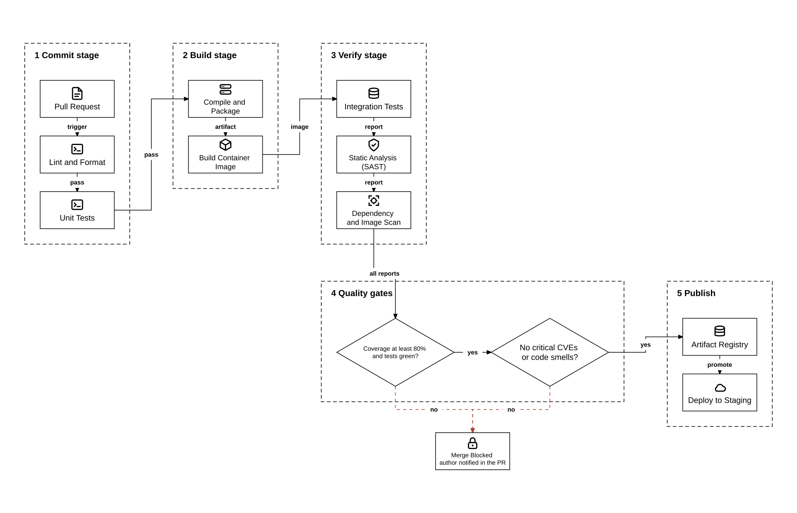

# Continuous Integration Pipeline with Quality Gates

## Bill of Materials

| Symbol / ID | Label | Kind | Group | Technical Notes / Metadata |
| :--- | :--- | :--- | :--- | :--- |
| `pr` | **Pull Request** | box | 1 Commit stage | trigger: push to feature branch |
| `lint` | **Lint and Format** | box | 1 Commit stage | tools: ruff, eslint |
| `unit` | **Unit Tests** | box | 1 Commit stage | budget: under 5 min |
| `compile` | **Compile and Package** | box | 2 Build stage | cache: remote build cache |
| `image` | **Build Container Image** | box | 2 Build stage | tag: git SHA |
| `integ` | **Integration Tests** | box | 3 Verify stage | env: ephemeral compose stack |
| `sast` | **Static Analysis (SAST)** | box | 3 Verify stage | tools: Semgrep, SonarQube |
| `deps` | **Dependency and Image Scan** | box | 3 Verify stage | tools: Trivy, Snyk |
| `gate_cov` | **Coverage at least 80% and tests green?** | diamond | 4 Quality gates | - |
| `gate_sec` | **No critical CVEs or code smells?** | diamond | 4 Quality gates | - |
| `registry` | **Artifact Registry** | box | 5 Publish | state: immutable tag |
| `deploy` | **Deploy to Staging** | box | 5 Publish | handoff: CD pipeline |
| `blocked` | **Merge Blocked author notified in the PR** | box | - | - |

## Connections

| Source | Target | Protocol / Label | Style | Routing |
| :--- | :--- | :--- | :--- | :--- |
| **Pull Request** (`pr`) | **Lint and Format** (`lint`) | trigger | solid | orthogonal |
| **Lint and Format** (`lint`) | **Unit Tests** (`unit`) | pass | solid | orthogonal |
| **Unit Tests** (`unit`) | **Compile and Package** (`compile`) | pass | solid | orthogonal |
| **Compile and Package** (`compile`) | **Build Container Image** (`image`) | artifact | solid | orthogonal |
| **Build Container Image** (`image`) | **Integration Tests** (`integ`) | image | solid | orthogonal |
| **Integration Tests** (`integ`) | **Static Analysis (SAST)** (`sast`) | report | solid | orthogonal |
| **Static Analysis (SAST)** (`sast`) | **Dependency and Image Scan** (`deps`) | report | solid | orthogonal |
| **Dependency and Image Scan** (`deps`) | **Coverage at least 80% and tests green?** (`gate_cov`) | all reports | solid | orthogonal |
| **Coverage at least 80% and tests green?** (`gate_cov`) | **No critical CVEs or code smells?** (`gate_sec`) | yes | solid | orthogonal |
| **No critical CVEs or code smells?** (`gate_sec`) | **Artifact Registry** (`registry`) | yes | solid | orthogonal |
| **Artifact Registry** (`registry`) | **Deploy to Staging** (`deploy`) | promote | solid | orthogonal |
| **Coverage at least 80% and tests green?** (`gate_cov`) | **Merge Blocked author notified in the PR** (`blocked`) | no | dashed | orthogonal |
| **No critical CVEs or code smells?** (`gate_sec`) | **Merge Blocked author notified in the PR** (`blocked`) | no | dashed | orthogonal |
