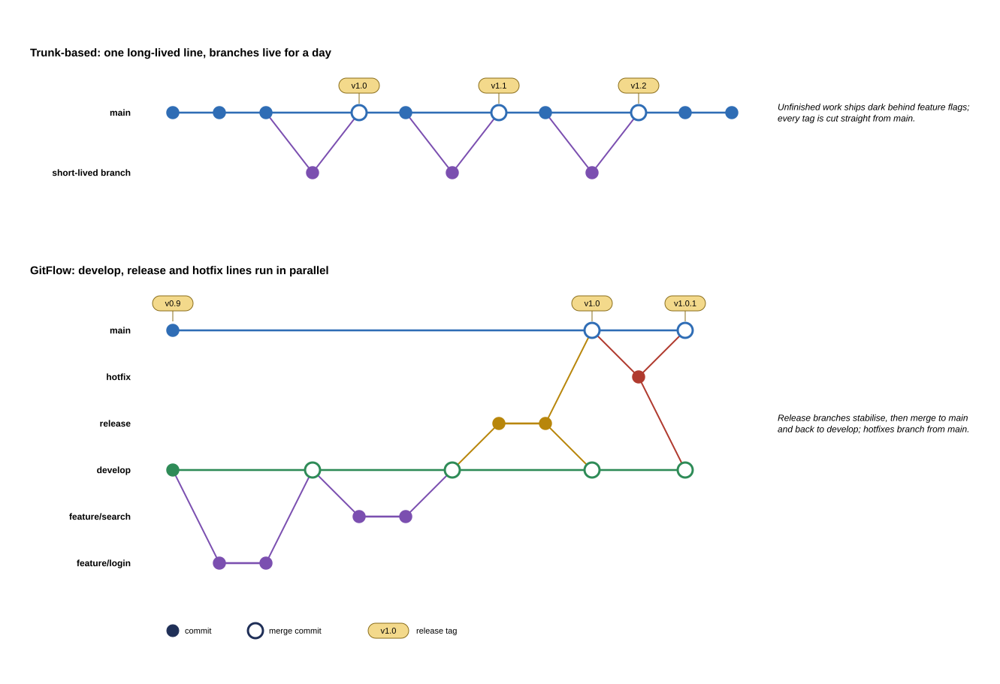

# Trunk-based development vs GitFlow

## Bill of Materials

| Symbol / ID | Label | Kind | Group | Technical Notes / Metadata |
| :--- | :--- | :--- | :--- | :--- |
| `shape_34` | **** | box | - | - |
| `shape_35` | **** | box | - | - |
| `shape_36` | **** | box | - | - |
| `shape_37` | **** | box | - | - |
| `shape_38` | **** | box | - | - |
| `shape_39` | **** | box | - | - |
| `shape_40` | **** | box | - | - |
| `shape_41` | **** | box | - | - |
| `shape_42` | **** | box | - | - |
| `shape_43` | **** | box | - | - |
| `shape_44` | **** | box | - | - |
| `shape_45` | **** | box | - | - |
| `shape_46` | **** | box | - | - |
| `shape_47` | **v1.0** | box | - | - |
| `shape_50` | **v1.1** | box | - | - |
| `shape_53` | **v1.2** | box | - | - |
| `shape_102` | **** | box | - | - |
| `shape_103` | **** | box | - | - |
| `shape_104` | **** | box | - | - |
| `shape_105` | **** | box | - | - |
| `shape_106` | **** | box | - | - |
| `shape_107` | **** | box | - | - |
| `shape_108` | **** | box | - | - |
| `shape_109` | **** | box | - | - |
| `shape_110` | **** | box | - | - |
| `shape_111` | **** | box | - | - |
| `shape_112` | **** | box | - | - |
| `shape_113` | **** | box | - | - |
| `shape_114` | **** | box | - | - |
| `shape_115` | **** | box | - | - |
| `shape_116` | **** | box | - | - |
| `shape_117` | **v0.9** | box | - | - |
| `shape_120` | **v1.0** | box | - | - |
| `shape_123` | **v1.0.1** | box | - | - |
| `shape_127` | **** | box | - | - |
| `shape_129` | **** | box | - | - |
| `shape_131` | **v1.0** | box | - | - |

## Connections

| Source | Target | Protocol / Label | Style | Routing |
| :--- | :--- | :--- | :--- | :--- |
| **point_4** (`point_4`) | **point_5** (`point_5`) | - | solid | direct |
| **point_6** (`point_6`) | **point_7** (`point_7`) | - | solid | direct |
| **point_8** (`point_8`) | **point_9** (`point_9`) | - | solid | direct |
| **point_10** (`point_10`) | **point_11** (`point_11`) | - | solid | direct |
| **point_12** (`point_12`) | **point_13** (`point_13`) | - | solid | direct |
| **point_14** (`point_14`) | **point_15** (`point_15`) | - | solid | direct |
| **point_16** (`point_16`) | **point_17** (`point_17`) | - | solid | direct |
| **point_18** (`point_18`) | **point_19** (`point_19`) | - | solid | direct |
| **point_20** (`point_20`) | **point_21** (`point_21`) | - | solid | direct |
| **point_22** (`point_22`) | **point_23** (`point_23`) | - | solid | direct |
| **point_24** (`point_24`) | **point_25** (`point_25`) | - | solid | direct |
| **point_26** (`point_26`) | **point_27** (`point_27`) | - | solid | direct |
| **point_28** (`point_28`) | **point_29** (`point_29`) | - | solid | direct |
| **point_30** (`point_30`) | **point_31** (`point_31`) | - | solid | direct |
| **point_32** (`point_32`) | **point_33** (`point_33`) | - | solid | direct |
| **point_48** (`point_48`) | **point_49** (`point_49`) | - | solid | direct |
| **point_51** (`point_51`) | **point_52** (`point_52`) | - | solid | direct |
| **point_54** (`point_54`) | **point_55** (`point_55`) | - | solid | direct |
| **point_64** (`point_64`) | **point_65** (`point_65`) | - | solid | direct |
| **point_66** (`point_66`) | **point_67** (`point_67`) | - | solid | direct |
| **point_68** (`point_68`) | **point_69** (`point_69`) | - | solid | direct |
| **point_70** (`point_70`) | **point_71** (`point_71`) | - | solid | direct |
| **point_72** (`point_72`) | **point_73** (`point_73`) | - | solid | direct |
| **point_74** (`point_74`) | **point_75** (`point_75`) | - | solid | direct |
| **point_76** (`point_76`) | **point_77** (`point_77`) | - | solid | direct |
| **point_78** (`point_78`) | **point_79** (`point_79`) | - | solid | direct |
| **point_80** (`point_80`) | **point_81** (`point_81`) | - | solid | direct |
| **point_82** (`point_82`) | **point_83** (`point_83`) | - | solid | direct |
| **point_84** (`point_84`) | **point_85** (`point_85`) | - | solid | direct |
| **point_86** (`point_86`) | **point_87** (`point_87`) | - | solid | direct |
| **point_88** (`point_88`) | **point_89** (`point_89`) | - | solid | direct |
| **point_90** (`point_90`) | **point_91** (`point_91`) | - | solid | direct |
| **point_92** (`point_92`) | **point_93** (`point_93`) | - | solid | direct |
| **point_94** (`point_94`) | **point_95** (`point_95`) | - | solid | direct |
| **point_96** (`point_96`) | **point_97** (`point_97`) | - | solid | direct |
| **point_98** (`point_98`) | **point_99** (`point_99`) | - | solid | direct |
| **point_100** (`point_100`) | **point_101** (`point_101`) | - | solid | direct |
| **point_118** (`point_118`) | **point_119** (`point_119`) | - | solid | direct |
| **point_121** (`point_121`) | **point_122** (`point_122`) | - | solid | direct |
| **point_124** (`point_124`) | **point_125** (`point_125`) | - | solid | direct |
