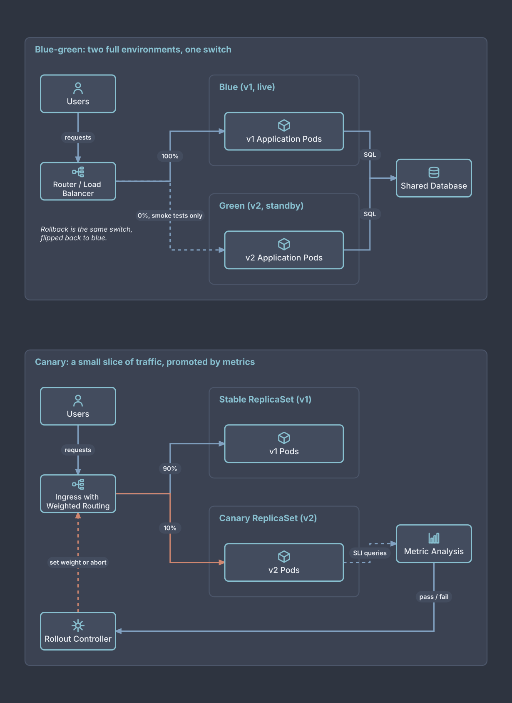

# Progressive Delivery: Blue-Green Cutover vs Canary Rollout

## Bill of Materials

| Symbol / ID | Label | Kind | Group | Technical Notes / Metadata |
| :--- | :--- | :--- | :--- | :--- |
| `bg_users` | **Users** | box | Blue-green: two full environments, one switch | traffic: all requests |
| `bg_router` | **Router / Load Balancer** | box | Blue-green: two full environments, one switch | control: atomic switch |
| `blue_app` | **v1 Application Pods** | box | Blue (v1, live) | replicas: 6 |
| `green_app` | **v2 Application Pods** | box | Green (v2, standby) | replicas: 6 |
| `bg_db` | **Shared Database** | box | Blue-green: two full environments, one switch | schema: backward compatible |
| `cn_users` | **Users** | box | Canary: a small slice of traffic, promoted by metrics | traffic: all requests |
| `cn_router` | **Ingress with Weighted Routing** | box | Canary: a small slice of traffic, promoted by metrics | control: weight per step |
| `stable_app` | **v1 Pods** | box | Stable ReplicaSet (v1) | replicas: 9 |
| `canary_app` | **v2 Pods** | box | Canary ReplicaSet (v2) | replicas: 1 |
| `analysis` | **Metric Analysis** | box | Canary: a small slice of traffic, promoted by metrics | slis: error rate, p99 latency |
| `controller` | **Rollout Controller** | box | Canary: a small slice of traffic, promoted by metrics | steps: 5, 25, 50, 100 percent |

## Connections

| Source | Target | Protocol / Label | Style | Routing |
| :--- | :--- | :--- | :--- | :--- |
| **Users** (`bg_users`) | **Router / Load Balancer** (`bg_router`) | requests | solid | orthogonal |
| **Router / Load Balancer** (`bg_router`) | **v1 Application Pods** (`blue_app`) | 100% | solid | orthogonal |
| **Router / Load Balancer** (`bg_router`) | **v2 Application Pods** (`green_app`) | 0%, smoke tests only | dashed | orthogonal |
| **v1 Application Pods** (`blue_app`) | **Shared Database** (`bg_db`) | SQL | solid | orthogonal |
| **v2 Application Pods** (`green_app`) | **Shared Database** (`bg_db`) | SQL | solid | orthogonal |
| **Users** (`cn_users`) | **Ingress with Weighted Routing** (`cn_router`) | requests | solid | orthogonal |
| **Ingress with Weighted Routing** (`cn_router`) | **v1 Pods** (`stable_app`) | 90% | solid | orthogonal |
| **Ingress with Weighted Routing** (`cn_router`) | **v2 Pods** (`canary_app`) | 10% | solid | orthogonal |
| **v2 Pods** (`canary_app`) | **Metric Analysis** (`analysis`) | SLI queries | dashed | orthogonal |
| **Metric Analysis** (`analysis`) | **Rollout Controller** (`controller`) | pass / fail | solid | orthogonal |
| **Rollout Controller** (`controller`) | **Ingress with Weighted Routing** (`cn_router`) | set weight or abort | dashed | orthogonal |
