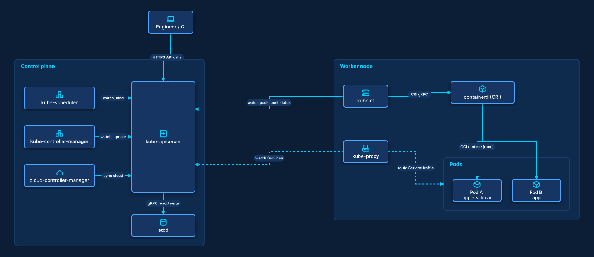

# Kubernetes Control Plane and Worker Node Anatomy

## Bill of Materials

| Symbol / ID | Label | Kind | Group | Technical Notes / Metadata |
| :--- | :--- | :--- | :--- | :--- |
| `user` | **Engineer / CI** | box | - | client: kubectl, Helm, Argo CD |
| `sched` | **kube-scheduler** | box | Control plane | job: bind pods to nodes |
| `ctrl` | **kube-controller-manager** | box | Control plane | job: reconcile desired state |
| `cloud` | **cloud-controller-manager** | box | Control plane | job: LBs, volumes, nodes |
| `api` | **kube-apiserver** | box | Control plane | job: REST front door, authN/Z, admission |
| `etcd` | **etcd** | box | Control plane | job: consistent key-value store |
| `kubelet` | **kubelet** | box | Worker node | job: run pods, report status |
| `proxy` | **kube-proxy** | box | Worker node | job: Service rules (iptables / IPVS) |
| `runtime` | **containerd (CRI)** | box | Worker node | job: pull images, start containers |
| `pod_a` | **Pod A app + sidecar** | box | Pods | - |
| `pod_b` | **Pod B app** | box | Pods | - |

## Connections

| Source | Target | Protocol / Label | Style | Routing |
| :--- | :--- | :--- | :--- | :--- |
| **Engineer / CI** (`user`) | **kube-apiserver** (`api`) | HTTPS API calls | solid | orthogonal |
| **kube-apiserver** (`api`) | **etcd** (`etcd`) | gRPC read / write | solid | orthogonal |
| **kube-scheduler** (`sched`) | **kube-apiserver** (`api`) | watch, bind | solid | direct |
| **kube-controller-manager** (`ctrl`) | **kube-apiserver** (`api`) | watch, update | solid | direct |
| **cloud-controller-manager** (`cloud`) | **kube-apiserver** (`api`) | sync cloud | solid | direct |
| **kubelet** (`kubelet`) | **kube-apiserver** (`api`) | watch pods, post status | solid | orthogonal |
| **kube-proxy** (`proxy`) | **kube-apiserver** (`api`) | watch Services | dashed | orthogonal |
| **kubelet** (`kubelet`) | **containerd (CRI)** (`runtime`) | CRI gRPC | solid | orthogonal |
| **containerd (CRI)** (`runtime`) | **Pod A app + sidecar** (`pod_a`) | OCI runtime (runc) | solid | orthogonal |
| **containerd (CRI)** (`runtime`) | **Pod B app** (`pod_b`) | - | solid | orthogonal |
| **kube-proxy** (`proxy`) | **Pods** (`group_3`) | route Service traffic | dashed | orthogonal |
