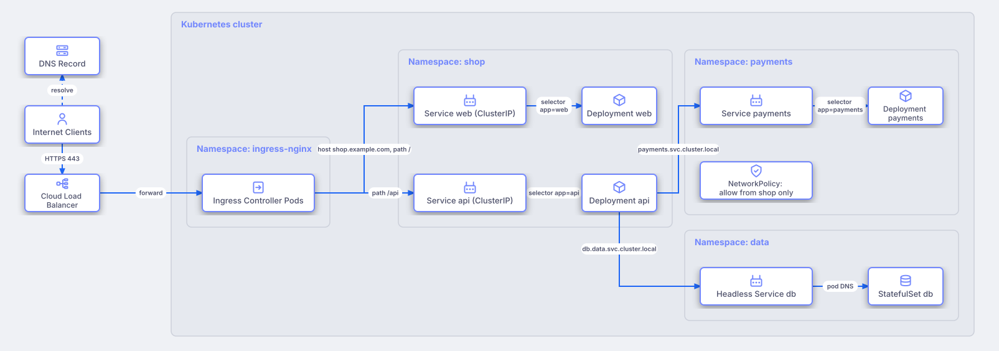

# Kubernetes Ingress, Namespace and Service Topology

## Bill of Materials

| Symbol / ID | Label | Kind | Group | Technical Notes / Metadata |
| :--- | :--- | :--- | :--- | :--- |
| `internet` | **Internet Clients** | box | - | host: shop.example.com |
| `dns` | **DNS Record** | box | - | type: A to load balancer |
| `lb` | **Cloud Load Balancer** | Service type LoadBalancer | - | - |
| `ctrl` | **Ingress Controller Pods** | box | Namespace: ingress-nginx | reads: Ingress rules, TLS secrets |
| `svc_web` | **Service web (ClusterIP)** | box | Namespace: shop | port: 80 |
| `web` | **Deployment web** | box | Namespace: shop | replicas: 3 |
| `svc_api` | **Service api (ClusterIP)** | box | Namespace: shop | port: 8080 |
| `api` | **Deployment api** | box | Namespace: shop | replicas: 4 |
| `svc_pay` | **Service payments** | box | Namespace: payments | port: 9000 |
| `pay` | **Deployment payments** | box | Namespace: payments | replicas: 2 |
| `policy` | **NetworkPolicy: allow from shop only** | box | Namespace: payments | rule: default deny, allow from shop |
| `svc_db` | **Headless Service db** | box | Namespace: data | port: 5432 |
| `db` | **StatefulSet db** | box | Namespace: data | volumes: PVC per pod |

## Connections

| Source | Target | Protocol / Label | Style | Routing |
| :--- | :--- | :--- | :--- | :--- |
| **Internet Clients** (`internet`) | **DNS Record** (`dns`) | resolve | dashed | orthogonal |
| **Internet Clients** (`internet`) | **Cloud Load Balancer** (`lb`) | HTTPS 443 | solid | orthogonal |
| **Cloud Load Balancer** (`lb`) | **Ingress Controller Pods** (`ctrl`) | forward | solid | orthogonal |
| **Ingress Controller Pods** (`ctrl`) | **Service web (ClusterIP)** (`svc_web`) | host shop.example.com, path / | solid | orthogonal |
| **Ingress Controller Pods** (`ctrl`) | **Service api (ClusterIP)** (`svc_api`) | path /api | solid | orthogonal |
| **Service web (ClusterIP)** (`svc_web`) | **Deployment web** (`web`) | selector app=web | solid | orthogonal |
| **Service api (ClusterIP)** (`svc_api`) | **Deployment api** (`api`) | selector app=api | solid | orthogonal |
| **Deployment api** (`api`) | **Service payments** (`svc_pay`) | payments.svc.cluster.local | solid | orthogonal |
| **Service payments** (`svc_pay`) | **Deployment payments** (`pay`) | selector app=payments | solid | orthogonal |
| **Deployment api** (`api`) | **Headless Service db** (`svc_db`) | db.data.svc.cluster.local | solid | orthogonal |
| **Headless Service db** (`svc_db`) | **StatefulSet db** (`db`) | pod DNS | solid | orthogonal |
