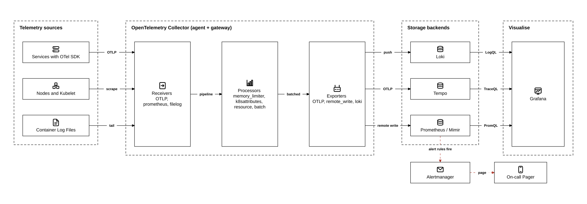

# Observability Stack: Metrics, Logs and Traces via the OpenTelemetry Collector

## Bill of Materials

| Symbol / ID | Label | Kind | Group | Technical Notes / Metadata |
| :--- | :--- | :--- | :--- | :--- |
| `app` | **Services with OTel SDK** | box | Telemetry sources | signals: traces, metrics, logs |
| `infra` | **Nodes and Kubelet** | box | Telemetry sources | signals: host and pod metrics |
| `files` | **Container Log Files** | box | Telemetry sources | signals: stdout / stderr |
| `rcv` | **Receivers OTLP, prometheus, filelog** | box | OpenTelemetry Collector (agent + gateway) | - |
| `proc` | **Processors memory_limiter, k8sattributes, resource, batch** | box | OpenTelemetry Collector (agent + gateway) | - |
| `exp` | **Exporters OTLP, remote_write, loki** | box | OpenTelemetry Collector (agent + gateway) | - |
| `logs` | **Loki** | box | Storage backends | signal: logs |
| `traces` | **Tempo** | box | Storage backends | signal: traces |
| `metrics` | **Prometheus / Mimir** | box | Storage backends | signal: metrics |
| `grafana` | **Grafana** | box | Visualise | role: dashboards, explore, trace-to-logs |
| `alert` | **Alertmanager** | box | - | routes: group, silence, route |
| `pager` | **On-call Pager** | box | - | duty: primary / secondary |

## Connections

| Source | Target | Protocol / Label | Style | Routing |
| :--- | :--- | :--- | :--- | :--- |
| **Services with OTel SDK** (`app`) | **Receivers OTLP, prometheus, filelog** (`rcv`) | OTLP | solid | direct |
| **Nodes and Kubelet** (`infra`) | **Receivers OTLP, prometheus, filelog** (`rcv`) | scrape | solid | direct |
| **Container Log Files** (`files`) | **Receivers OTLP, prometheus, filelog** (`rcv`) | tail | solid | direct |
| **Receivers OTLP, prometheus, filelog** (`rcv`) | **Processors memory_limiter, k8sattributes, resource, batch** (`proc`) | pipeline | solid | orthogonal |
| **Processors memory_limiter, k8sattributes, resource, batch** (`proc`) | **Exporters OTLP, remote_write, loki** (`exp`) | batched | solid | orthogonal |
| **Exporters OTLP, remote_write, loki** (`exp`) | **Loki** (`logs`) | push | solid | direct |
| **Exporters OTLP, remote_write, loki** (`exp`) | **Tempo** (`traces`) | OTLP | solid | direct |
| **Exporters OTLP, remote_write, loki** (`exp`) | **Prometheus / Mimir** (`metrics`) | remote write | solid | direct |
| **Loki** (`logs`) | **Grafana** (`grafana`) | LogQL | solid | direct |
| **Tempo** (`traces`) | **Grafana** (`grafana`) | TraceQL | solid | direct |
| **Prometheus / Mimir** (`metrics`) | **Grafana** (`grafana`) | PromQL | solid | direct |
| **Prometheus / Mimir** (`metrics`) | **Alertmanager** (`alert`) | alert rules fire | dashed | orthogonal |
| **Alertmanager** (`alert`) | **On-call Pager** (`pager`) | page | dashed | orthogonal |
