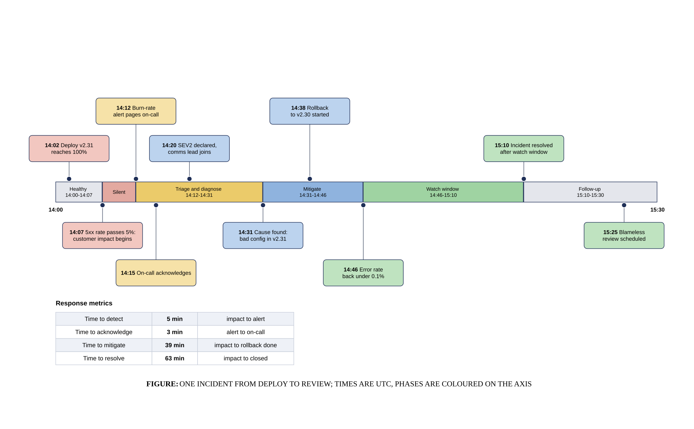

# Incident timeline: checkout 5xx after a bad deploy

## Bill of Materials

| Symbol / ID | Label | Kind | Group | Technical Notes / Metadata |
| :--- | :--- | :--- | :--- | :--- |
| `shape_1` | **Healthy 14:00-14:07** | box | - | - |
| `shape_2` | **Silent** | box | - | - |
| `shape_3` | **Triage and diagnose 14:12-14:31** | box | - | - |
| `shape_4` | **Mitigate 14:31-14:46** | box | - | - |
| `shape_5` | **Watch window 14:46-15:10** | box | - | - |
| `shape_6` | **Follow-up 15:10-15:30** | box | - | - |
| `shape_11` | ****14:02** Deploy v2.31 reaches 100%** | box | - | - |
| `shape_12` | **** | box | - | - |
| `shape_15` | ****14:12** Burn-rate alert pages on-call** | box | - | - |
| `shape_16` | **** | box | - | - |
| `shape_19` | ****14:20** SEV2 declared, comms lead joins** | box | - | - |
| `shape_20` | **** | box | - | - |
| `shape_23` | ****14:38** Rollback to v2.30 started** | box | - | - |
| `shape_24` | **** | box | - | - |
| `shape_27` | ****15:10** Incident resolved after watch window** | box | - | - |
| `shape_28` | **** | box | - | - |
| `shape_31` | ****14:07** 5xx rate passes 5%: customer impact begins** | box | - | - |
| `shape_32` | **** | box | - | - |
| `shape_35` | ****14:15** On-call acknowledges** | box | - | - |
| `shape_36` | **** | box | - | - |
| `shape_39` | ****14:31** Cause found: bad config in v2.31** | box | - | - |
| `shape_40` | **** | box | - | - |
| `shape_43` | ****14:46** Error rate back under 0.1%** | box | - | - |
| `shape_44` | **** | box | - | - |
| `shape_47` | ****15:25** Blameless review scheduled** | box | - | - |
| `shape_48` | **** | box | - | - |
| `shape_50` | **Time to detect** | box | - | - |
| `shape_51` | ****5 min**** | box | - | - |
| `shape_52` | **impact to alert** | box | - | - |
| `shape_53` | **Time to acknowledge** | box | - | - |
| `shape_54` | ****3 min**** | box | - | - |
| `shape_55` | **alert to on-call** | box | - | - |
| `shape_56` | **Time to mitigate** | box | - | - |
| `shape_57` | ****39 min**** | box | - | - |
| `shape_58` | **impact to rollback done** | box | - | - |
| `shape_59` | **Time to resolve** | box | - | - |
| `shape_60` | ****63 min**** | box | - | - |
| `shape_61` | **impact to closed** | box | - | - |

## Connections

| Source | Target | Protocol / Label | Style | Routing |
| :--- | :--- | :--- | :--- | :--- |
| **point_9** (`point_9`) | **point_10** (`point_10`) | - | solid | direct |
| **point_13** (`point_13`) | **point_14** (`point_14`) | - | solid | direct |
| **point_17** (`point_17`) | **point_18** (`point_18`) | - | solid | direct |
| **point_21** (`point_21`) | **point_22** (`point_22`) | - | solid | direct |
| **point_25** (`point_25`) | **point_26** (`point_26`) | - | solid | direct |
| **point_29** (`point_29`) | **point_30** (`point_30`) | - | solid | direct |
| **point_33** (`point_33`) | **point_34** (`point_34`) | - | solid | direct |
| **point_37** (`point_37`) | **point_38** (`point_38`) | - | solid | direct |
| **point_41** (`point_41`) | **point_42** (`point_42`) | - | solid | direct |
| **point_45** (`point_45`) | **point_46** (`point_46`) | - | solid | direct |
