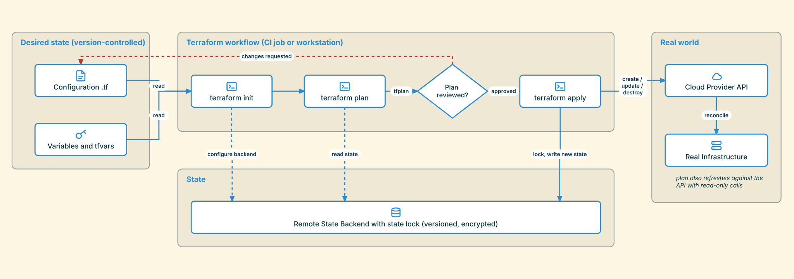

# Terraform Plan and Apply: Desired State, Recorded State, Real Infrastructure

## Bill of Materials

| Symbol / ID | Label | Kind | Group | Technical Notes / Metadata |
| :--- | :--- | :--- | :--- | :--- |
| `config` | **Configuration .tf** | box | Desired state (version-controlled) | content: resources, modules |
| `tfvars` | **Variables and tfvars** | box | Desired state (version-controlled) | content: per-environment inputs |
| `init` | **terraform init** | box | Terraform workflow (CI job or workstation) | does: providers, modules, backend |
| `plan` | **terraform plan** | box | Terraform workflow (CI job or workstation) | does: refresh, diff, plan file |
| `review` | **Plan reviewed?** | diamond | Terraform workflow (CI job or workstation) | - |
| `apply` | **terraform apply** | box | Terraform workflow (CI job or workstation) | does: execute saved plan |
| `state` | **Remote State Backend with state lock (versioned, encrypted)** | box | State | lock: held during apply |
| `api` | **Cloud Provider API** | box | Real world | auth: short-lived credentials |
| `infra` | **Real Infrastructure** | box | Real world | drift: changed outside Terraform |

## Connections

| Source | Target | Protocol / Label | Style | Routing |
| :--- | :--- | :--- | :--- | :--- |
| **Configuration .tf** (`config`) | **terraform init** (`init`) | read | solid | orthogonal |
| **Variables and tfvars** (`tfvars`) | **terraform init** (`init`) | read | solid | orthogonal |
| **terraform init** (`init`) | **terraform plan** (`plan`) | - | solid | orthogonal |
| **terraform plan** (`plan`) | **Plan reviewed?** (`review`) | tfplan | solid | orthogonal |
| **Plan reviewed?** (`review`) | **terraform apply** (`apply`) | approved | solid | orthogonal |
| **Plan reviewed?** (`review`) | **Configuration .tf** (`config`) | changes requested | dashed | orthogonal |
| **terraform init** (`init`) | **Remote State Backend with state lock (versioned, encrypted)** (`state`) | configure backend | dashed | orthogonal |
| **terraform plan** (`plan`) | **Remote State Backend with state lock (versioned, encrypted)** (`state`) | read state | dashed | orthogonal |
| **terraform apply** (`apply`) | **Remote State Backend with state lock (versioned, encrypted)** (`state`) | lock, write new state | solid | orthogonal |
| **terraform apply** (`apply`) | **Cloud Provider API** (`api`) | create / update / destroy | solid | orthogonal |
| **Cloud Provider API** (`api`) | **Real Infrastructure** (`infra`) | reconcile | solid | orthogonal |
