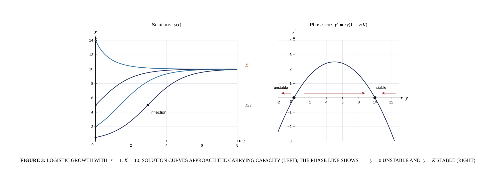

# Logistic growth

## Bill of Materials

| Symbol / ID | Label | Kind | Group | Technical Notes / Metadata |
| :--- | :--- | :--- | :--- | :--- |

## Connections

| Source | Target | Protocol / Label | Style | Routing |
| :--- | :--- | :--- | :--- | :--- |
| **point_2** (`point_2`) | **point_3** (`point_3`) | - | solid | direct |
| **point_4** (`point_4`) | **point_5** (`point_5`) | - | solid | direct |
| **point_37** (`point_37`) | **point_38** (`point_38`) | - | solid | direct |
| **point_39** (`point_39`) | **point_40** (`point_40`) | - | solid | direct |
| **point_61** (`point_61`) | **point_62** (`point_62`) | - | solid | direct |
| **point_63** (`point_63`) | **point_64** (`point_64`) | - | solid | direct |
| **point_65** (`point_65`) | **point_66** (`point_66`) | - | solid | direct |
