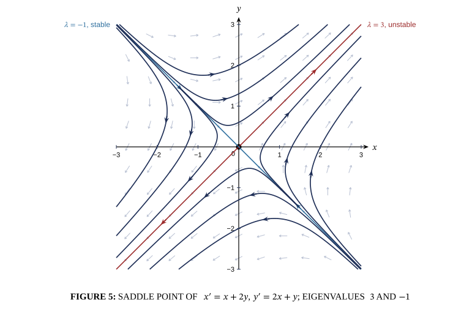

# Saddle point phase portrait

## Bill of Materials

| Symbol / ID | Label | Kind | Group | Technical Notes / Metadata |
| :--- | :--- | :--- | :--- | :--- |

## Connections

| Source | Target | Protocol / Label | Style | Routing |
| :--- | :--- | :--- | :--- | :--- |
| **point_2** (`point_2`) | **point_3** (`point_3`) | - | solid | direct |
| **point_4** (`point_4`) | **point_5** (`point_5`) | - | solid | direct |
| **point_25** (`point_25`) | **point_26** (`point_26`) | - | solid | direct |
| **point_28** (`point_28`) | **point_29** (`point_29`) | - | solid | direct |
| **point_31** (`point_31`) | **point_32** (`point_32`) | - | solid | direct |
| **point_34** (`point_34`) | **point_35** (`point_35`) | - | solid | direct |
| **point_37** (`point_37`) | **point_38** (`point_38`) | - | solid | direct |
| **point_40** (`point_40`) | **point_41** (`point_41`) | - | solid | direct |
| **point_43** (`point_43`) | **point_44** (`point_44`) | - | solid | direct |
| **point_46** (`point_46`) | **point_47** (`point_47`) | - | solid | direct |
| **point_49** (`point_49`) | **point_50** (`point_50`) | - | solid | direct |
| **point_52** (`point_52`) | **point_53** (`point_53`) | - | solid | direct |
| **point_55** (`point_55`) | **point_56** (`point_56`) | - | solid | direct |
| **point_58** (`point_58`) | **point_59** (`point_59`) | - | solid | direct |
| **point_60** (`point_60`) | **point_61** (`point_61`) | - | solid | direct |
| **point_62** (`point_62`) | **point_63** (`point_63`) | - | solid | direct |
| **point_64** (`point_64`) | **point_65** (`point_65`) | - | solid | direct |
| **point_66** (`point_66`) | **point_67** (`point_67`) | - | solid | direct |
