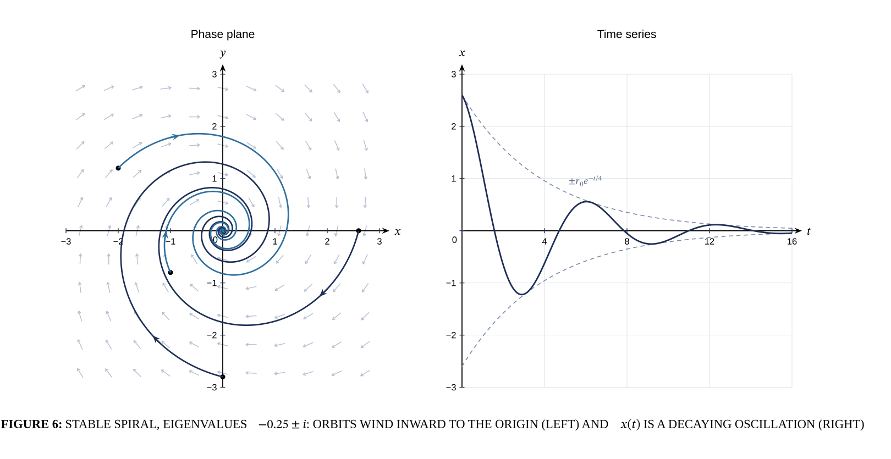

# Stable spiral phase portrait

## Bill of Materials

| Symbol / ID | Label | Kind | Group | Technical Notes / Metadata |
| :--- | :--- | :--- | :--- | :--- |

## Connections

| Source | Target | Protocol / Label | Style | Routing |
| :--- | :--- | :--- | :--- | :--- |
| **point_2** (`point_2`) | **point_3** (`point_3`) | - | solid | direct |
| **point_4** (`point_4`) | **point_5** (`point_5`) | - | solid | direct |
| **point_23** (`point_23`) | **point_24** (`point_24`) | - | solid | direct |
| **point_27** (`point_27`) | **point_28** (`point_28`) | - | solid | direct |
| **point_31** (`point_31`) | **point_32** (`point_32`) | - | solid | direct |
| **point_35** (`point_35`) | **point_36** (`point_36`) | - | solid | direct |
| **point_41** (`point_41`) | **point_42** (`point_42`) | - | solid | direct |
| **point_43** (`point_43`) | **point_44** (`point_44`) | - | solid | direct |
