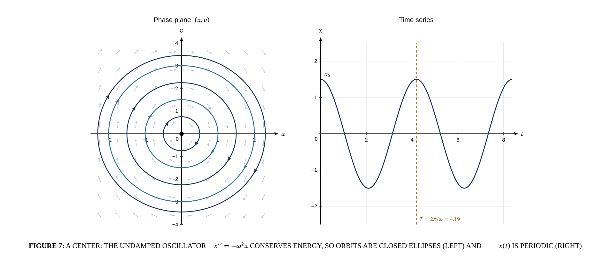

# Center phase portrait

## Bill of Materials

| Symbol / ID | Label | Kind | Group | Technical Notes / Metadata |
| :--- | :--- | :--- | :--- | :--- |

## Connections

| Source | Target | Protocol / Label | Style | Routing |
| :--- | :--- | :--- | :--- | :--- |
| **point_2** (`point_2`) | **point_3** (`point_3`) | - | solid | direct |
| **point_4** (`point_4`) | **point_5** (`point_5`) | - | solid | direct |
| **point_23** (`point_23`) | **point_24** (`point_24`) | - | solid | direct |
| **point_25** (`point_25`) | **point_26** (`point_26`) | - | solid | direct |
| **point_28** (`point_28`) | **point_29** (`point_29`) | - | solid | direct |
| **point_30** (`point_30`) | **point_31** (`point_31`) | - | solid | direct |
| **point_33** (`point_33`) | **point_34** (`point_34`) | - | solid | direct |
| **point_35** (`point_35`) | **point_36** (`point_36`) | - | solid | direct |
| **point_38** (`point_38`) | **point_39** (`point_39`) | - | solid | direct |
| **point_40** (`point_40`) | **point_41** (`point_41`) | - | solid | direct |
| **point_43** (`point_43`) | **point_44** (`point_44`) | - | solid | direct |
| **point_45** (`point_45`) | **point_46** (`point_46`) | - | solid | direct |
| **point_50** (`point_50`) | **point_51** (`point_51`) | - | solid | direct |
| **point_52** (`point_52`) | **point_53** (`point_53`) | - | solid | direct |
