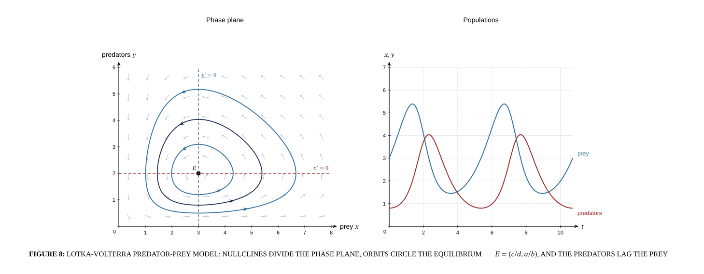

# Lotka-Volterra phase plane

## Bill of Materials

| Symbol / ID | Label | Kind | Group | Technical Notes / Metadata |
| :--- | :--- | :--- | :--- | :--- |

## Connections

| Source | Target | Protocol / Label | Style | Routing |
| :--- | :--- | :--- | :--- | :--- |
| **point_2** (`point_2`) | **point_3** (`point_3`) | - | solid | direct |
| **point_4** (`point_4`) | **point_5** (`point_5`) | - | solid | direct |
| **point_29** (`point_29`) | **point_30** (`point_30`) | - | solid | direct |
| **point_31** (`point_31`) | **point_32** (`point_32`) | - | solid | direct |
| **point_34** (`point_34`) | **point_35** (`point_35`) | - | solid | direct |
| **point_36** (`point_36`) | **point_37** (`point_37`) | - | solid | direct |
| **point_39** (`point_39`) | **point_40** (`point_40`) | - | solid | direct |
| **point_41** (`point_41`) | **point_42** (`point_42`) | - | solid | direct |
| **point_47** (`point_47`) | **point_48** (`point_48`) | - | solid | direct |
| **point_49** (`point_49`) | **point_50** (`point_50`) | - | solid | direct |
