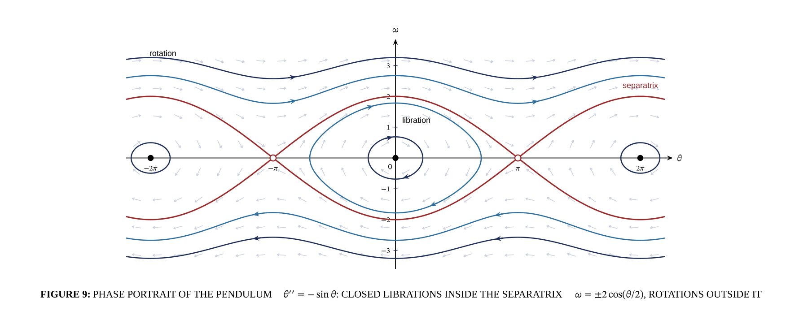

# Pendulum phase portrait

## Bill of Materials

| Symbol / ID | Label | Kind | Group | Technical Notes / Metadata |
| :--- | :--- | :--- | :--- | :--- |

## Connections

| Source | Target | Protocol / Label | Style | Routing |
| :--- | :--- | :--- | :--- | :--- |
| **point_1** (`point_1`) | **point_2** (`point_2`) | - | solid | direct |
| **point_3** (`point_3`) | **point_4** (`point_4`) | - | solid | direct |
| **point_27** (`point_27`) | **point_28** (`point_28`) | - | solid | direct |
| **point_29** (`point_29`) | **point_30** (`point_30`) | - | solid | direct |
| **point_32** (`point_32`) | **point_33** (`point_33`) | - | solid | direct |
| **point_34** (`point_34`) | **point_35** (`point_35`) | - | solid | direct |
| **point_39** (`point_39`) | **point_40** (`point_40`) | - | solid | direct |
| **point_41** (`point_41`) | **point_42** (`point_42`) | - | solid | direct |
| **point_44** (`point_44`) | **point_45** (`point_45`) | - | solid | direct |
| **point_46** (`point_46`) | **point_47** (`point_47`) | - | solid | direct |
| **point_49** (`point_49`) | **point_50** (`point_50`) | - | solid | direct |
| **point_51** (`point_51`) | **point_52** (`point_52`) | - | solid | direct |
| **point_54** (`point_54`) | **point_55** (`point_55`) | - | solid | direct |
| **point_56** (`point_56`) | **point_57** (`point_57`) | - | solid | direct |
