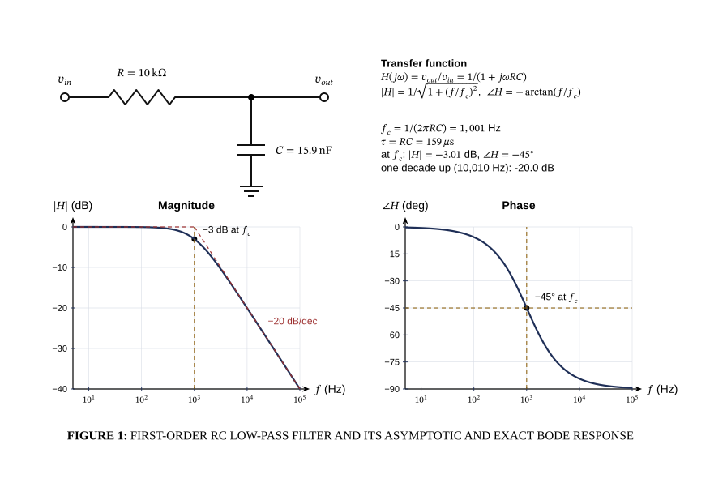

# RC low-pass filter with its Bode plot

## Bill of Materials

| Symbol / ID | Label | Kind | Group | Technical Notes / Metadata |
| :--- | :--- | :--- | :--- | :--- |

## Connections

| Source | Target | Protocol / Label | Style | Routing |
| :--- | :--- | :--- | :--- | :--- |
| **point_14** (`point_14`) | **point_15** (`point_15`) | - | solid | direct |
| **point_16** (`point_16`) | **point_17** (`point_17`) | - | solid | direct |
| **point_40** (`point_40`) | **point_41** (`point_41`) | - | solid | direct |
| **point_42** (`point_42`) | **point_43** (`point_43`) | - | solid | direct |
