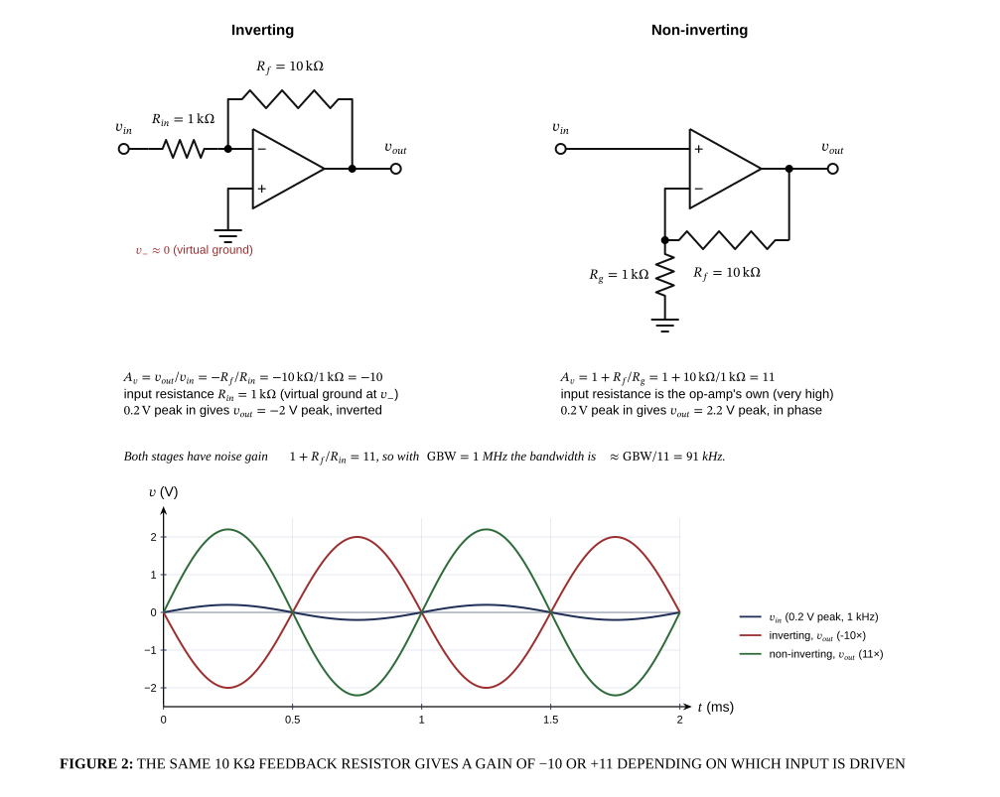

# Inverting and non-inverting op-amp amplifiers

## Bill of Materials

| Symbol / ID | Label | Kind | Group | Technical Notes / Metadata |
| :--- | :--- | :--- | :--- | :--- |

## Connections

| Source | Target | Protocol / Label | Style | Routing |
| :--- | :--- | :--- | :--- | :--- |
| **point_36** (`point_36`) | **point_37** (`point_37`) | - | solid | direct |
| **point_38** (`point_38`) | **point_39** (`point_39`) | - | solid | direct |
