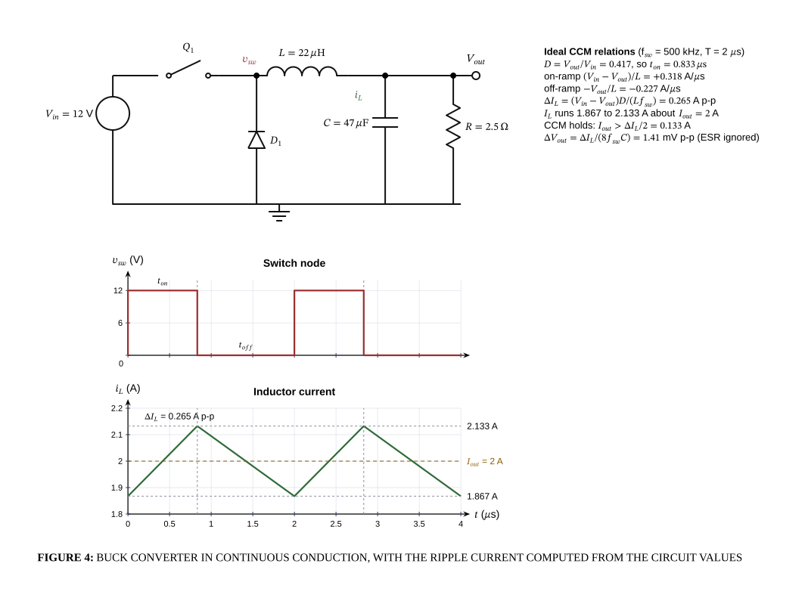

# Buck converter and its inductor current

## Bill of Materials

| Symbol / ID | Label | Kind | Group | Technical Notes / Metadata |
| :--- | :--- | :--- | :--- | :--- |

## Connections

| Source | Target | Protocol / Label | Style | Routing |
| :--- | :--- | :--- | :--- | :--- |
| **point_27** (`point_27`) | **point_28** (`point_28`) | - | solid | direct |
| **point_29** (`point_29`) | **point_30** (`point_30`) | - | solid | direct |
| **point_43** (`point_43`) | **point_44** (`point_44`) | - | solid | direct |
| **point_45** (`point_45`) | **point_46** (`point_46`) | - | solid | direct |
