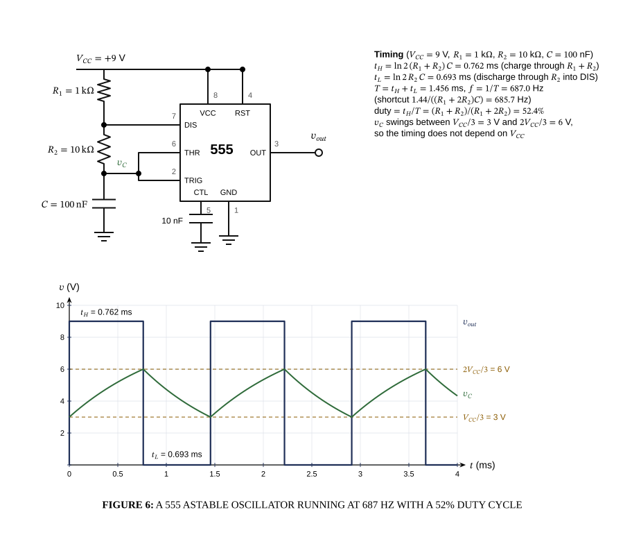

# 555 timer astable oscillator

## Bill of Materials

| Symbol / ID | Label | Kind | Group | Technical Notes / Metadata |
| :--- | :--- | :--- | :--- | :--- |

## Connections

| Source | Target | Protocol / Label | Style | Routing |
| :--- | :--- | :--- | :--- | :--- |
| **point_40** (`point_40`) | **point_41** (`point_41`) | - | solid | direct |
| **point_42** (`point_42`) | **point_43** (`point_43`) | - | solid | direct |
