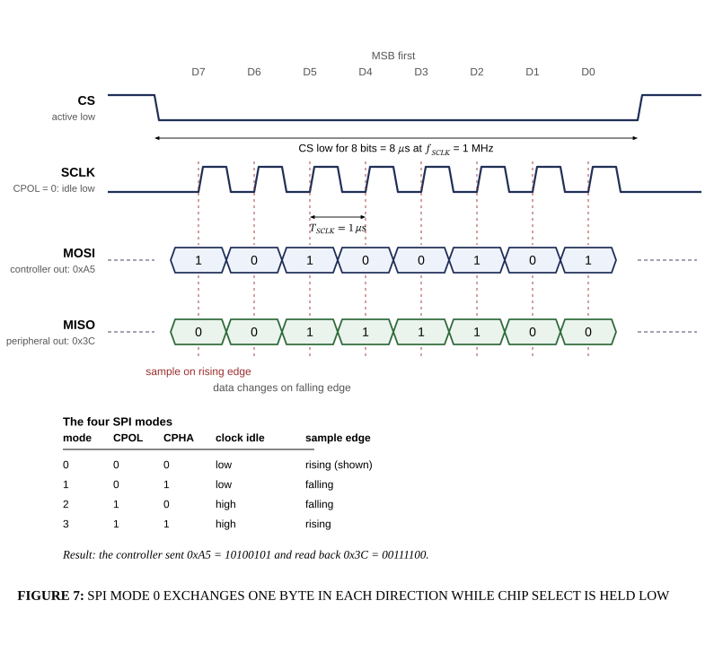

# SPI mode 0 timing

## Bill of Materials

| Symbol / ID | Label | Kind | Group | Technical Notes / Metadata |
| :--- | :--- | :--- | :--- | :--- |

## Connections

| Source | Target | Protocol / Label | Style | Routing |
| :--- | :--- | :--- | :--- | :--- |
| **point_64** (`point_64`) | **point_65** (`point_65`) | - | solid | direct |
| **point_67** (`point_67`) | **point_68** (`point_68`) | - | solid | direct |
