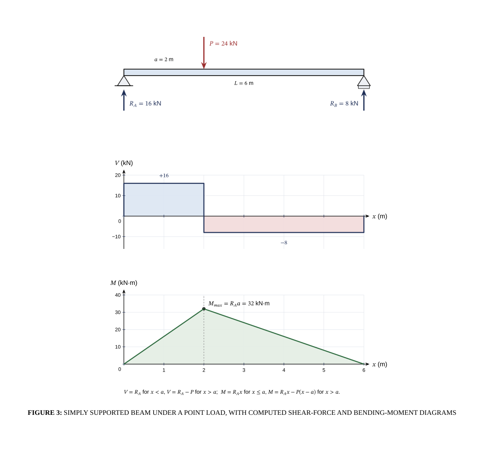

# Beam shear and moment

## Bill of Materials

| Symbol / ID | Label | Kind | Group | Technical Notes / Metadata |
| :--- | :--- | :--- | :--- | :--- |

## Connections

| Source | Target | Protocol / Label | Style | Routing |
| :--- | :--- | :--- | :--- | :--- |
| **point_6** (`point_6`) | **point_7** (`point_7`) | - | solid | direct |
| **point_9** (`point_9`) | **point_10** (`point_10`) | - | solid | direct |
| **point_11** (`point_11`) | **point_12** (`point_12`) | - | solid | direct |
| **point_18** (`point_18`) | **point_19** (`point_19`) | - | solid | direct |
| **point_20** (`point_20`) | **point_21** (`point_21`) | - | solid | direct |
| **point_35** (`point_35`) | **point_36** (`point_36`) | - | solid | direct |
| **point_37** (`point_37`) | **point_38** (`point_38`) | - | solid | direct |
