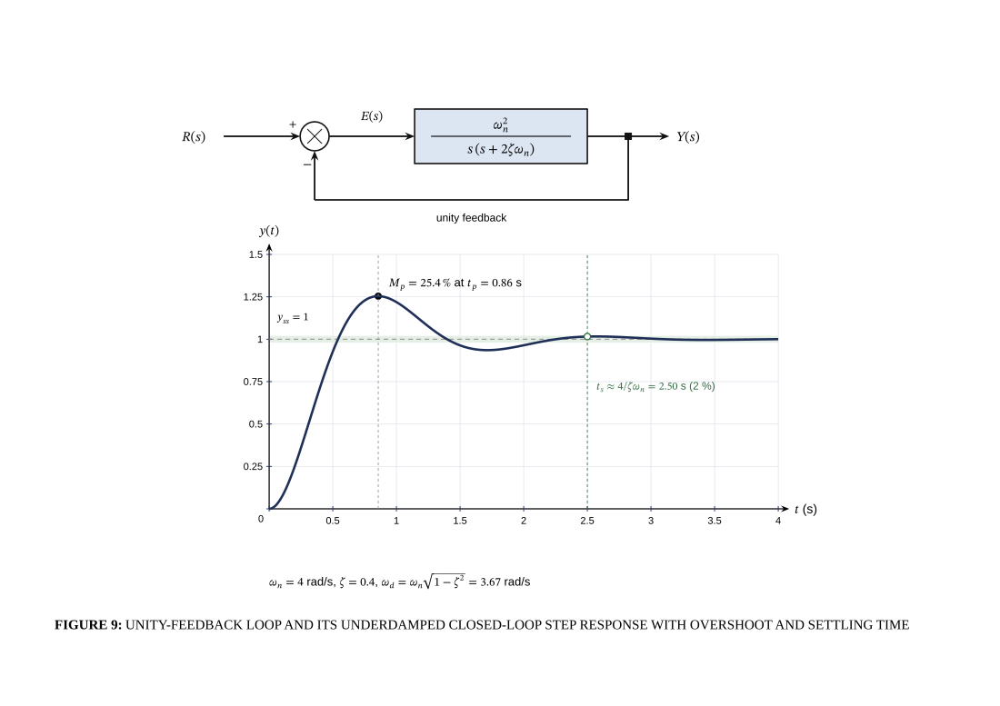

# Feedback loop and step response

## Bill of Materials

| Symbol / ID | Label | Kind | Group | Technical Notes / Metadata |
| :--- | :--- | :--- | :--- | :--- |

## Connections

| Source | Target | Protocol / Label | Style | Routing |
| :--- | :--- | :--- | :--- | :--- |
| **point_9** (`point_9`) | **point_10** (`point_10`) | - | solid | direct |
| **point_13** (`point_13`) | **point_14** (`point_14`) | - | solid | direct |
| **point_15** (`point_15`) | **point_16** (`point_16`) | - | solid | direct |
| **point_19** (`point_19`) | **point_20** (`point_20`) | - | solid | direct |
| **point_24** (`point_24`) | **point_25** (`point_25`) | - | solid | direct |
| **point_26** (`point_26`) | **point_27** (`point_27`) | - | solid | direct |
