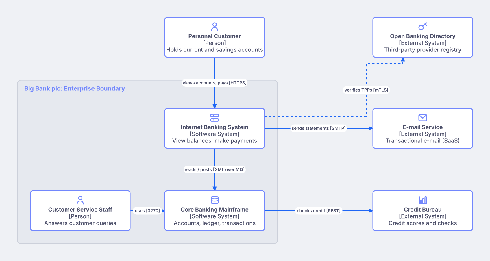

# C4 System Context: Retail Internet Banking

## Bill of Materials

| Symbol / ID | Label | Kind | Group | Technical Notes / Metadata |
| :--- | :--- | :--- | :--- | :--- |
| `customer` | ****Personal Customer** [Person] Holds current and savings accounts** | box | - | c4: Person, scope: External |
| `banking` | ****Internet Banking System** [Software System] View balances, make payments** | box | Big Bank plc: Enterprise Boundary | c4: Software System, owner: Digital Channels |
| `mainframe` | ****Core Banking Mainframe** [Software System] Accounts, ledger, transactions** | box | Big Bank plc: Enterprise Boundary | c4: Software System, owner: Core Platforms |
| `staff` | ****Customer Service Staff** [Person] Answers customer queries** | box | Big Bank plc: Enterprise Boundary | c4: Person, scope: Internal |
| `idp` | ****Open Banking Directory** [External System] Third-party provider registry** | box | - | c4: External System, provider: OBIE |
| `email` | ****E-mail Service** [External System] Transactional e-mail (SaaS)** | box | - | c4: External System, provider: SendGrid |
| `credit` | ****Credit Bureau** [External System] Credit scores and checks** | box | - | c4: External System, provider: Experian |

## Connections

| Source | Target | Protocol / Label | Style | Routing |
| :--- | :--- | :--- | :--- | :--- |
| ****Personal Customer** [Person] Holds current and savings accounts** (`customer`) | ****Internet Banking System** [Software System] View balances, make payments** (`banking`) | views accounts, pays [HTTPS] | solid | orthogonal |
| ****Internet Banking System** [Software System] View balances, make payments** (`banking`) | ****Core Banking Mainframe** [Software System] Accounts, ledger, transactions** (`mainframe`) | reads / posts [XML over MQ] | solid | orthogonal |
| ****Internet Banking System** [Software System] View balances, make payments** (`banking`) | ****E-mail Service** [External System] Transactional e-mail (SaaS)** (`email`) | sends statements [SMTP] | solid | orthogonal |
| ****Internet Banking System** [Software System] View balances, make payments** (`banking`) | ****Open Banking Directory** [External System] Third-party provider registry** (`idp`) | verifies TPPs [mTLS] | dashed | orthogonal |
| ****Customer Service Staff** [Person] Answers customer queries** (`staff`) | ****Core Banking Mainframe** [Software System] Accounts, ledger, transactions** (`mainframe`) | uses [3270] | solid | orthogonal |
| ****Core Banking Mainframe** [Software System] Accounts, ledger, transactions** (`mainframe`) | ****Credit Bureau** [External System] Credit scores and checks** (`credit`) | checks credit [REST] | solid | orthogonal |
