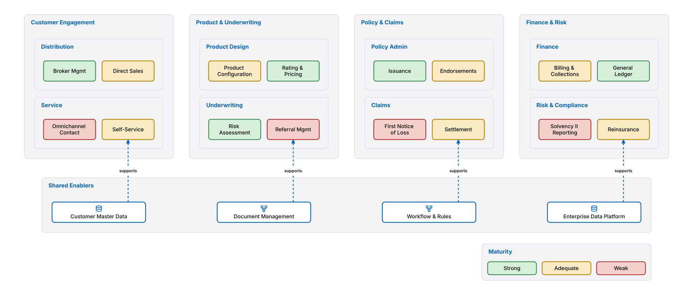

# Insurance Business Capability Map with Maturity Heatmap

## Bill of Materials

| Symbol / ID | Label | Kind | Group | Technical Notes / Metadata |
| :--- | :--- | :--- | :--- | :--- |
| `shape_3` | **Broker Mgmt** | box | Distribution | level: L3, domain: Customer Engagement, group: Distribution, maturity: strong |
| `shape_4` | **Direct Sales** | box | Distribution | level: L3, domain: Customer Engagement, group: Distribution, maturity: adequate |
| `shape_6` | **Omnichannel Contact** | box | Service | level: L3, domain: Customer Engagement, group: Service, maturity: weak |
| `shape_7` | **Self-Service** | box | Service | level: L3, domain: Customer Engagement, group: Service, maturity: adequate |
| `shape_10` | **Product Configuration** | box | Product Design | level: L3, domain: Product & Underwriting, group: Product Design, maturity: adequate |
| `shape_11` | **Rating & Pricing** | box | Product Design | level: L3, domain: Product & Underwriting, group: Product Design, maturity: strong |
| `shape_13` | **Risk Assessment** | box | Underwriting | level: L3, domain: Product & Underwriting, group: Underwriting, maturity: strong |
| `shape_14` | **Referral Mgmt** | box | Underwriting | level: L3, domain: Product & Underwriting, group: Underwriting, maturity: weak |
| `shape_17` | **Issuance** | box | Policy Admin | level: L3, domain: Policy & Claims, group: Policy Admin, maturity: strong |
| `shape_18` | **Endorsements** | box | Policy Admin | level: L3, domain: Policy & Claims, group: Policy Admin, maturity: adequate |
| `shape_20` | **First Notice of Loss** | box | Claims | level: L3, domain: Policy & Claims, group: Claims, maturity: weak |
| `shape_21` | **Settlement** | box | Claims | level: L3, domain: Policy & Claims, group: Claims, maturity: adequate |
| `shape_24` | **Billing & Collections** | box | Finance | level: L3, domain: Finance & Risk, group: Finance, maturity: adequate |
| `shape_25` | **General Ledger** | box | Finance | level: L3, domain: Finance & Risk, group: Finance, maturity: strong |
| `shape_27` | **Solvency II Reporting** | box | Risk & Compliance | level: L3, domain: Finance & Risk, group: Risk & Compliance, maturity: weak |
| `shape_28` | **Reinsurance** | box | Risk & Compliance | level: L3, domain: Finance & Risk, group: Risk & Compliance, maturity: adequate |
| `shape_30` | **Customer Master Data** | box | Shared Enablers | level: L1, type: Enabling |
| `shape_31` | **Document Management** | box | Shared Enablers | level: L1, type: Enabling |
| `shape_32` | **Workflow & Rules** | box | Shared Enablers | level: L1, type: Enabling |
| `shape_33` | **Enterprise Data Platform** | box | Shared Enablers | level: L1, type: Enabling |
| `shape_35` | **Strong** | box | Maturity | legend: maturity |
| `shape_36` | **Adequate** | box | Maturity | legend: maturity |
| `shape_37` | **Weak** | box | Maturity | legend: maturity |

## Connections

| Source | Target | Protocol / Label | Style | Routing |
| :--- | :--- | :--- | :--- | :--- |
| **Customer Master Data** (`shape_30`) | **Self-Service** (`shape_7`) | supports | dashed | orthogonal |
| **Document Management** (`shape_31`) | **Referral Mgmt** (`shape_14`) | supports | dashed | orthogonal |
| **Workflow & Rules** (`shape_32`) | **Settlement** (`shape_21`) | supports | dashed | orthogonal |
| **Enterprise Data Platform** (`shape_33`) | **Reinsurance** (`shape_28`) | supports | dashed | orthogonal |
