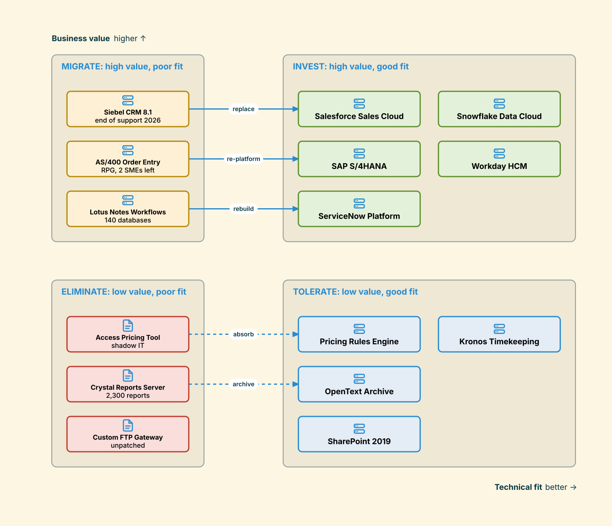

# Application Portfolio Rationalisation (TIME Model)

## Bill of Materials

| Symbol / ID | Label | Kind | Group | Technical Notes / Metadata |
| :--- | :--- | :--- | :--- | :--- |
| `shape_2` | ****Siebel CRM 8.1** end of support 2026** | box | MIGRATE: high value, poor fit | lifecycle: Migrate, owner: Sales, cost: $1.4M/yr |
| `shape_3` | ****AS/400 Order Entry** RPG, 2 SMEs left** | box | MIGRATE: high value, poor fit | lifecycle: Migrate, owner: Operations, cost: $0.9M/yr |
| `shape_4` | ****Lotus Notes Workflows** 140 databases** | box | MIGRATE: high value, poor fit | lifecycle: Migrate, owner: Shared Services, cost: $0.3M/yr |
| `shape_6` | ****Salesforce Sales Cloud**** | box | INVEST: high value, good fit | lifecycle: Invest, owner: Sales, cost: $2.1M/yr |
| `shape_7` | ****SAP S/4HANA**** | box | INVEST: high value, good fit | lifecycle: Invest, owner: Finance, cost: $3.8M/yr |
| `shape_8` | ****ServiceNow Platform**** | box | INVEST: high value, good fit | lifecycle: Invest, owner: IT, cost: $1.2M/yr |
| `shape_9` | ****Snowflake Data Cloud**** | box | INVEST: high value, good fit | lifecycle: Invest, owner: Data Office, cost: $0.8M/yr |
| `shape_10` | ****Workday HCM**** | box | INVEST: high value, good fit | lifecycle: Invest, owner: HR, cost: $1.0M/yr |
| `shape_12` | ****Access Pricing Tool** shadow IT** | box | ELIMINATE: low value, poor fit | lifecycle: Eliminate, owner: Marketing, cost: $0.05M/yr |
| `shape_13` | ****Crystal Reports Server** 2,300 reports** | box | ELIMINATE: low value, poor fit | lifecycle: Eliminate, owner: Finance, cost: $0.2M/yr |
| `shape_14` | ****Custom FTP Gateway** unpatched** | box | ELIMINATE: low value, poor fit | lifecycle: Eliminate, owner: IT, cost: $0.1M/yr |
| `shape_16` | ****Pricing Rules Engine**** | box | TOLERATE: low value, good fit | lifecycle: Tolerate, owner: Marketing, cost: $0.2M/yr |
| `shape_17` | ****OpenText Archive**** | box | TOLERATE: low value, good fit | lifecycle: Tolerate, owner: Records, cost: $0.4M/yr |
| `shape_18` | ****SharePoint 2019**** | box | TOLERATE: low value, good fit | lifecycle: Tolerate, owner: Workplace, cost: $0.3M/yr |
| `shape_19` | ****Kronos Timekeeping**** | box | TOLERATE: low value, good fit | lifecycle: Tolerate, owner: HR, cost: $0.2M/yr |

## Connections

| Source | Target | Protocol / Label | Style | Routing |
| :--- | :--- | :--- | :--- | :--- |
| ****Siebel CRM 8.1** end of support 2026** (`shape_2`) | ****Salesforce Sales Cloud**** (`shape_6`) | replace | solid | orthogonal |
| ****AS/400 Order Entry** RPG, 2 SMEs left** (`shape_3`) | ****SAP S/4HANA**** (`shape_7`) | re-platform | solid | orthogonal |
| ****Lotus Notes Workflows** 140 databases** (`shape_4`) | ****ServiceNow Platform**** (`shape_8`) | rebuild | solid | orthogonal |
| ****Access Pricing Tool** shadow IT** (`shape_12`) | ****Pricing Rules Engine**** (`shape_16`) | absorb | dashed | orthogonal |
| ****Crystal Reports Server** 2,300 reports** (`shape_13`) | ****OpenText Archive**** (`shape_17`) | archive | dashed | orthogonal |
