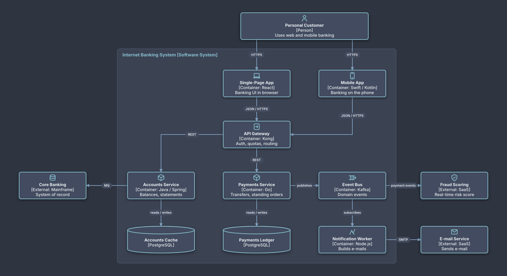

# C4 Container View: Internet Banking System

## Bill of Materials

| Symbol / ID | Label | Kind | Group | Technical Notes / Metadata |
| :--- | :--- | :--- | :--- | :--- |
| `shape_1` | ****Personal Customer** [Person] Uses web and mobile banking** | box | - | c4: Person |
| `shape_3` | ****Single-Page App** [Container: React] Banking UI in browser** | box | Internet Banking System [Software System] | c4: Container: React |
| `shape_4` | ****Mobile App** [Container: Swift / Kotlin] Banking on the phone** | box | Internet Banking System [Software System] | c4: Container: Swift / Kotlin |
| `shape_5` | ****API Gateway** [Container: Kong] Auth, quotas, routing** | box | Internet Banking System [Software System] | c4: Container: Kong |
| `shape_6` | ****Accounts Service** [Container: Java / Spring] Balances, statements** | box | Internet Banking System [Software System] | c4: Container: Java / Spring |
| `shape_7` | ****Payments Service** [Container: Go] Transfers, standing orders** | box | Internet Banking System [Software System] | c4: Container: Go |
| `shape_8` | ****Event Bus** [Container: Kafka] Domain events** | box | Internet Banking System [Software System] | c4: Container: Kafka |
| `shape_9` | ****Accounts Cache** [PostgreSQL]** | cylinder | Internet Banking System [Software System] | c4: Container: Database |
| `shape_10` | ****Payments Ledger** [PostgreSQL]** | cylinder | Internet Banking System [Software System] | c4: Container: Database |
| `shape_11` | ****Notification Worker** [Container: Node.js] Builds e-mails** | box | Internet Banking System [Software System] | c4: Container: Node.js |
| `shape_12` | ****Core Banking** [External: Mainframe] System of record** | box | - | c4: External: Mainframe |
| `shape_13` | ****Fraud Scoring** [External: SaaS] Real-time risk score** | box | - | c4: External: SaaS |
| `shape_14` | ****E-mail Service** [External: SaaS] Sends e-mail** | box | - | c4: External: SaaS |

## Connections

| Source | Target | Protocol / Label | Style | Routing |
| :--- | :--- | :--- | :--- | :--- |
| ****Personal Customer** [Person] Uses web and mobile banking** (`shape_1`) | ****Single-Page App** [Container: React] Banking UI in browser** (`shape_3`) | HTTPS | solid | orthogonal |
| ****Personal Customer** [Person] Uses web and mobile banking** (`shape_1`) | ****Mobile App** [Container: Swift / Kotlin] Banking on the phone** (`shape_4`) | HTTPS | solid | orthogonal |
| ****Single-Page App** [Container: React] Banking UI in browser** (`shape_3`) | ****API Gateway** [Container: Kong] Auth, quotas, routing** (`shape_5`) | JSON / HTTPS | solid | orthogonal |
| ****Mobile App** [Container: Swift / Kotlin] Banking on the phone** (`shape_4`) | ****API Gateway** [Container: Kong] Auth, quotas, routing** (`shape_5`) | JSON / HTTPS | solid | orthogonal |
| ****API Gateway** [Container: Kong] Auth, quotas, routing** (`shape_5`) | ****Accounts Service** [Container: Java / Spring] Balances, statements** (`shape_6`) | REST | solid | orthogonal |
| ****API Gateway** [Container: Kong] Auth, quotas, routing** (`shape_5`) | ****Payments Service** [Container: Go] Transfers, standing orders** (`shape_7`) | REST | solid | orthogonal |
| ****Accounts Service** [Container: Java / Spring] Balances, statements** (`shape_6`) | ****Accounts Cache** [PostgreSQL]** (`shape_9`) | reads / writes | solid | orthogonal |
| ****Payments Service** [Container: Go] Transfers, standing orders** (`shape_7`) | ****Payments Ledger** [PostgreSQL]** (`shape_10`) | reads / writes | solid | orthogonal |
| ****Accounts Service** [Container: Java / Spring] Balances, statements** (`shape_6`) | ****Core Banking** [External: Mainframe] System of record** (`shape_12`) | MQ | solid | orthogonal |
| ****Payments Service** [Container: Go] Transfers, standing orders** (`shape_7`) | ****Event Bus** [Container: Kafka] Domain events** (`shape_8`) | publishes | solid | orthogonal |
| ****Event Bus** [Container: Kafka] Domain events** (`shape_8`) | ****Fraud Scoring** [External: SaaS] Real-time risk score** (`shape_13`) | payment events | solid | orthogonal |
| ****Event Bus** [Container: Kafka] Domain events** (`shape_8`) | ****Notification Worker** [Container: Node.js] Builds e-mails** (`shape_11`) | subscribes | solid | orthogonal |
| ****Notification Worker** [Container: Node.js] Builds e-mails** (`shape_11`) | ****E-mail Service** [External: SaaS] Sends e-mail** (`shape_14`) | SMTP | solid | orthogonal |
