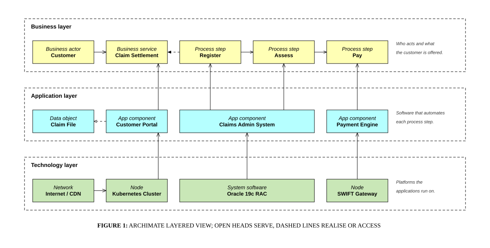

# ArchiMate Layered View: Insurance Claims Handling

## Bill of Materials

| Symbol / ID | Label | Kind | Group | Technical Notes / Metadata |
| :--- | :--- | :--- | :--- | :--- |
| `shape_2` | ***Business actor* **Customer**** | box | Business layer | archimate: Business Actor |
| `shape_3` | ***Business service* **Claim Settlement**** | box | Business layer | archimate: Business Service |
| `shape_4` | ***Process step* **Register**** | box | Business layer | archimate: Business Process |
| `shape_5` | ***Process step* **Assess**** | box | Business layer | archimate: Business Process |
| `shape_6` | ***Process step* **Pay**** | box | Business layer | archimate: Business Process |
| `shape_8` | ***Data object* **Claim File**** | box | Application layer | archimate: Data Object |
| `shape_9` | ***App component* **Customer Portal**** | box | Application layer | archimate: Application Component |
| `shape_10` | ***App component* **Claims Admin System**** | box | Application layer | archimate: Application Component |
| `shape_11` | ***App component* **Payment Engine**** | box | Application layer | archimate: Application Component |
| `shape_13` | ***Network* **Internet / CDN**** | box | Technology layer | archimate: Communication Network |
| `shape_14` | ***Node* **Kubernetes Cluster**** | box | Technology layer | archimate: Node |
| `shape_15` | ***System software* **Oracle 19c RAC**** | box | Technology layer | archimate: System Software |
| `shape_16` | ***Node* **SWIFT Gateway**** | box | Technology layer | archimate: Node |

## Connections

| Source | Target | Protocol / Label | Style | Routing |
| :--- | :--- | :--- | :--- | :--- |
| ***Business actor* **Customer**** (`shape_2`) | ***Business service* **Claim Settlement**** (`shape_3`) | - | solid | orthogonal |
| ***Process step* **Register**** (`shape_4`) | ***Business service* **Claim Settlement**** (`shape_3`) | - | dashed | orthogonal |
| ***Process step* **Register**** (`shape_4`) | ***Process step* **Assess**** (`shape_5`) | - | solid | orthogonal |
| ***Process step* **Assess**** (`shape_5`) | ***Process step* **Pay**** (`shape_6`) | - | solid | orthogonal |
| ***App component* **Customer Portal**** (`shape_9`) | ***Business service* **Claim Settlement**** (`shape_3`) | - | solid | orthogonal |
| ***App component* **Customer Portal**** (`shape_9`) | ***Data object* **Claim File**** (`shape_8`) | - | dashed | orthogonal |
| ***App component* **Claims Admin System**** (`shape_10`) | ***Process step* **Register**** (`shape_4`) | - | solid | orthogonal |
| ***App component* **Claims Admin System**** (`shape_10`) | ***Process step* **Assess**** (`shape_5`) | - | solid | orthogonal |
| ***App component* **Payment Engine**** (`shape_11`) | ***Process step* **Pay**** (`shape_6`) | - | solid | orthogonal |
| ***Node* **Kubernetes Cluster**** (`shape_14`) | ***App component* **Customer Portal**** (`shape_9`) | - | solid | orthogonal |
| ***Network* **Internet / CDN**** (`shape_13`) | ***Node* **Kubernetes Cluster**** (`shape_14`) | - | solid | orthogonal |
| ***System software* **Oracle 19c RAC**** (`shape_15`) | ***App component* **Claims Admin System**** (`shape_10`) | - | solid | orthogonal |
| ***Node* **SWIFT Gateway**** (`shape_16`) | ***App component* **Payment Engine**** (`shape_11`) | - | solid | orthogonal |
