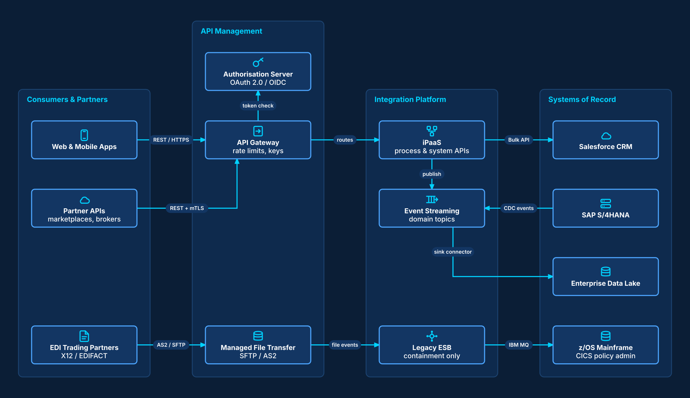

# Enterprise Integration Architecture: API, Event and ESB Patterns

## Bill of Materials

| Symbol / ID | Label | Kind | Group | Technical Notes / Metadata |
| :--- | :--- | :--- | :--- | :--- |
| `shape_2` | ****Web & Mobile Apps**** | box | Consumers & Partners | pattern: API consumer |
| `shape_3` | ****Partner APIs** marketplaces, brokers** | box | Consumers & Partners | pattern: API consumer |
| `shape_4` | ****EDI Trading Partners** X12 / EDIFACT** | box | Consumers & Partners | pattern: File exchange |
| `shape_6` | ****Authorisation Server** OAuth 2.0 / OIDC** | box | API Management | product: Okta |
| `shape_7` | ****API Gateway** rate limits, keys** | box | API Management | product: Apigee X |
| `shape_8` | ****Managed File Transfer** SFTP / AS2** | box | API Management | product: GoAnywhere |
| `shape_10` | ****iPaaS** process & system APIs** | box | Integration Platform | product: MuleSoft Anypoint |
| `shape_11` | ****Event Streaming** domain topics** | box | Integration Platform | product: Confluent Cloud |
| `shape_12` | ****Legacy ESB** containment only** | box | Integration Platform | product: IBM App Connect, lifecycle: Tolerate |
| `shape_14` | ****Salesforce CRM**** | box | Systems of Record | domain: Customer |
| `shape_15` | ****SAP S/4HANA**** | box | Systems of Record | domain: Finance & Supply |
| `shape_16` | ****Enterprise Data Lake**** | box | Systems of Record | domain: Analytics |
| `shape_17` | ****z/OS Mainframe** CICS policy admin** | box | Systems of Record | domain: Policy |

## Connections

| Source | Target | Protocol / Label | Style | Routing |
| :--- | :--- | :--- | :--- | :--- |
| ****Web & Mobile Apps**** (`shape_2`) | ****API Gateway** rate limits, keys** (`shape_7`) | REST / HTTPS | solid | orthogonal |
| ****Partner APIs** marketplaces, brokers** (`shape_3`) | ****API Gateway** rate limits, keys** (`shape_7`) | REST + mTLS | solid | orthogonal |
| ****API Gateway** rate limits, keys** (`shape_7`) | ****Authorisation Server** OAuth 2.0 / OIDC** (`shape_6`) | token check | solid | orthogonal |
| ****API Gateway** rate limits, keys** (`shape_7`) | ****iPaaS** process & system APIs** (`shape_10`) | routes | solid | orthogonal |
| ****iPaaS** process & system APIs** (`shape_10`) | ****Salesforce CRM**** (`shape_14`) | Bulk API | solid | orthogonal |
| ****iPaaS** process & system APIs** (`shape_10`) | ****Event Streaming** domain topics** (`shape_11`) | publish | solid | orthogonal |
| ****SAP S/4HANA**** (`shape_15`) | ****Event Streaming** domain topics** (`shape_11`) | CDC events | solid | orthogonal |
| ****Event Streaming** domain topics** (`shape_11`) | ****Enterprise Data Lake**** (`shape_16`) | sink connector | solid | orthogonal |
| ****EDI Trading Partners** X12 / EDIFACT** (`shape_4`) | ****Managed File Transfer** SFTP / AS2** (`shape_8`) | AS2 / SFTP | solid | orthogonal |
| ****Managed File Transfer** SFTP / AS2** (`shape_8`) | ****Legacy ESB** containment only** (`shape_12`) | file events | solid | orthogonal |
| ****Legacy ESB** containment only** (`shape_12`) | ****z/OS Mainframe** CICS policy admin** (`shape_17`) | IBM MQ | solid | orthogonal |
