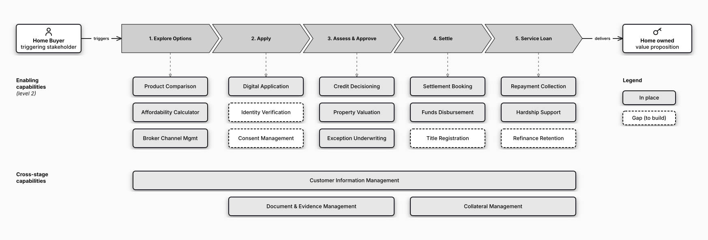

# Value Stream to Capability Cross-Map: Acquire a Home Loan

## Bill of Materials

| Symbol / ID | Label | Kind | Group | Technical Notes / Metadata |
| :--- | :--- | :--- | :--- | :--- |
| `shape_1` | ****Home Buyer** triggering stakeholder** | box | - | role: Triggering stakeholder |
| `shape_7` | ****Home owned** value proposition** | box | - | role: Value item |
| `shape_9` | **Product Comparison** | box | - | stage: Explore Options, status: In place |
| `shape_10` | **Affordability Calculator** | box | - | stage: Explore Options, status: In place |
| `shape_11` | **Broker Channel Mgmt** | box | - | stage: Explore Options, status: In place |
| `shape_12` | **Digital Application** | box | - | stage: Apply, status: In place |
| `shape_13` | **Identity Verification** | box | - | stage: Apply, status: Gap |
| `shape_14` | **Consent Management** | box | - | stage: Apply, status: Gap |
| `shape_15` | **Credit Decisioning** | box | - | stage: Assess & Approve, status: In place |
| `shape_16` | **Property Valuation** | box | - | stage: Assess & Approve, status: In place |
| `shape_17` | **Exception Underwriting** | box | - | stage: Assess & Approve, status: In place |
| `shape_18` | **Settlement Booking** | box | - | stage: Settle, status: In place |
| `shape_19` | **Funds Disbursement** | box | - | stage: Settle, status: In place |
| `shape_20` | **Title Registration** | box | - | stage: Settle, status: Gap |
| `shape_21` | **Repayment Collection** | box | - | stage: Service Loan, status: In place |
| `shape_22` | **Hardship Support** | box | - | stage: Service Loan, status: In place |
| `shape_23` | **Refinance Retention** | box | - | stage: Service Loan, status: Gap |
| `shape_25` | **Customer Information Management** | box | - | stages: 1-5, status: In place |
| `shape_26` | **Document & Evidence Management** | box | - | stages: 2-3, status: In place |
| `shape_27` | **Collateral Management** | box | - | stages: 4-5, status: In place |
| `shape_36` | **In place** | box | - | legend: status |
| `shape_37` | **Gap (to build)** | box | - | legend: status |

## Connections

| Source | Target | Protocol / Label | Style | Routing |
| :--- | :--- | :--- | :--- | :--- |
| ****Home Buyer** triggering stakeholder** (`shape_1`) | **point_28** (`point_28`) | triggers | solid | direct |
| **point_29** (`point_29`) | ****Home owned** value proposition** (`shape_7`) | delivers | solid | direct |
| **point_30** (`point_30`) | **Product Comparison** (`shape_9`) | - | dashed | direct |
| **point_31** (`point_31`) | **Digital Application** (`shape_12`) | - | dashed | direct |
| **point_32** (`point_32`) | **Credit Decisioning** (`shape_15`) | - | dashed | direct |
| **point_33** (`point_33`) | **Settlement Booking** (`shape_18`) | - | dashed | direct |
| **point_34** (`point_34`) | **Repayment Collection** (`shape_21`) | - | dashed | direct |
